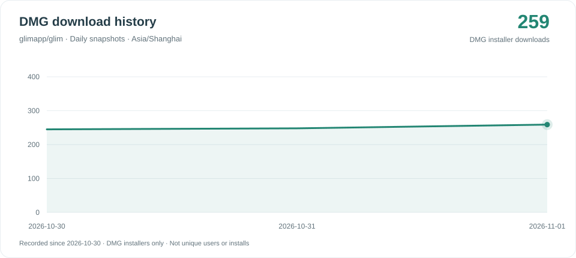

# Glim DMG download history

Daily snapshots count only `.dmg` installer assets of published GitHub Releases, including prereleases. Draft releases, ZIPs, feeds, checksum files and other attachments are excluded. Automatic-update and verification requests for DMGs are included; counts are downloads, not unique users or installations.

The README badge and both charts share the same daily observation. DMG-only tracking begins on **2026-10-30**, with the cumulative download counts of all currently published DMG installers, including older releases. Earlier observations stored only all-asset aggregates and cannot be split reliably by file type; they are preserved separately and are not joined to the DMG curve.

One observation is kept per date in Asia/Shanghai; another run on the same date refreshes that point. The graph shows the latest 90 observations. Gaps are not estimated. Totals can decrease if release assets are removed. Each new snapshot retains individual DMG asset IDs, names, release tags and counts for future reconciliation.

- [DMG observations](downloads.json)
- [Badge data](downloads-badge.json)
- [Legacy all-asset observations](downloads-all-assets-legacy.json)
- [Collector](https://github.com/glimapp/glim/blob/main/scripts/update-download-history.py)
- [Workflow](https://github.com/glimapp/glim/actions/workflows/download-history.yml)

The workflow runs daily at 00:17 Asia/Shanghai or manually. GitHub schedules can be delayed. Failed collection leaves previously published output unchanged.

## 中文

仅统计公开 Release（含预发布）的 `.dmg` 安装包，排除草稿、ZIP、更新清单、校验文件等其他附件。DMG 的自动更新及核验下载也会计入，下载次数不等于独立用户数或实际安装量。

徽标、浅色及深色曲线共用每日快照。纯 DMG 曲线从 **2026-10-30** 开始，累计值包含旧版 DMG 至今的下载次数。此前只保存全附件合计，无法准确拆分，已单独归档，不与 DMG 曲线拼接。新快照保留逐个 DMG 的资产 ID、名称、发布标签和计数，便于核对。

按上海时区每天保留一条观测，同日重跑更新当天记录；曲线显示最近 90 条观测，不估算缺失数据。计划每天 00:17 运行，也可手动触发；GitHub 调度可能延迟，采集失败保留上次发布结果。
