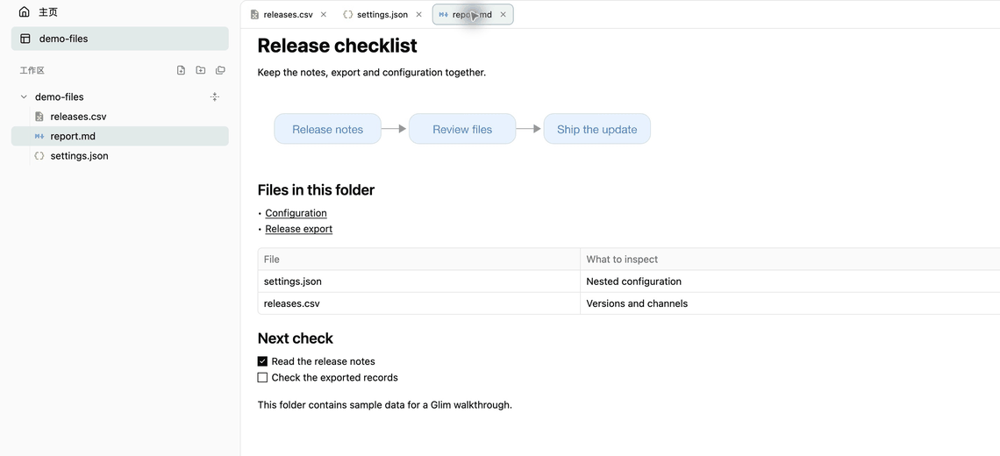

# Glim · Your files in one Mac workspace

Glim is a free, open-source file viewer for Mac. Read Markdown with Mermaid diagrams, inspect JSON trees and CSV tables, and keep PDFs, images, Office documents and code in adjacent tabs. Ordinary UTF-8 text supports small edits and saving.

Free and open source · macOS · Apple Silicon &amp; Intel · <b>English</b> / <a href="README.zh-CN.md">简体中文</a>

<a href="https://glimapp.github.io/?utm_source=github&amp;utm_medium=referral&amp;utm_campaign=readme">Website / 官网</a> · <a href="https://github.com/glimapp/glim/releases/latest"><strong>Download Glim →</strong></a>

<a href="https://github.com/glimapp/glim/releases/latest">Latest release · Release notes &amp; checksums</a> · <a href="#download">Installation help</a>

Mac downloads are not yet notarized by Apple. You may need to approve the first launch in System Settings. <a href="#macos">See instructions</a>

  
  
  
  

## Try three files in one folder

[Markdown and Mermaid](https://glimapp.github.io/markdown-viewer/?utm_source=github&utm_medium=referral&utm_campaign=readme) · [JSON trees](https://glimapp.github.io/json-viewer/?utm_source=github&utm_medium=referral&utm_campaign=readme) · [CSV tables](https://glimapp.github.io/csv-viewer/?utm_source=github&utm_medium=referral&utm_campaign=readme)

Each walkthrough includes a downloadable sample. Keep `report.md`, `settings.json` and `releases.csv` in one folder, open it with ⌘⇧O, then inspect the document, configuration and export. Source edits save automatically to the original file; use a copy when experimenting.

See a 16-second screenshot walkthrough

This sequence uses actual app screenshots and sample data; it does not demonstrate loading speed. You can also [choose each view on the website](https://glimapp.github.io/?utm_source=github&utm_medium=referral&utm_campaign=readme#walkthrough).

## What would you use Glim for?

At work, you might need a contract, a spreadsheet and a presentation together. When studying, you might have PDFs, ebooks and notes. A project folder can mix images, data and code. Glim keeps those files in a workspace for the task you are doing.

| Topic | Who it helps and what you can do |
| --- | --- |
| [Office files](docs/topics.md#office) | Read contracts, reports, spreadsheets and presentations |
| [Reading and study](docs/topics.md#reading) | Read PDFs, ebooks, comics and study notes |
| [Images and design assets](docs/topics.md#images) | View photos, animation, SVGs and fonts; copy images or extract image text |
| [Audio, video and subtitles](docs/topics.md#media) | Play local media and folder playlists; read and edit subtitles separately |
| [Notes and mind maps](docs/topics.md#notes) | Write Markdown and read XMind files, flowcharts and diagrams |
| [Tables and data](docs/topics.md#data) | Inspect CSV tables, JSON trees and interactive data graphs |
| [Databases](docs/topics.md#database) | Browse local SQLite tables, structure and records in read-only snapshots |
| [Developers](docs/topics.md#developer) | Read source, webpages, configuration, logs and technical docs; make basic text edits |
| [2D graphics and 3D models](docs/topics.md#graphics) | View SVGs, technical diagrams and static OBJ/STL mesh projections |
| [GIS and tracks](docs/topics.md#gis) | Inspect GeoJSON fields and GPX/KML coordinates and source |
| [AI and research files](docs/topics.md#research) | Inspect model metadata, selected NumPy values and notebook structures |
| [Archives and handoffs](docs/topics.md#archives) | Browse and extract ZIPs to a new directory, or inspect TAR listings and compressed text |

[Explore tasks and limitations by topic](docs/topics.md) · [Look up a file format](docs/file-format-support.md)

## Open a folder and keep related files together

Use a workspace for the files behind a task. Find files in the sidebar and switch between tabs. A window can hold multiple workspaces, and a file tab can move to its own window. Windows, workspaces and file tabs can return after restarting; general scroll positions and media playback positions are not fully restored.

## Look at the data behind a document

If a local database sits beside your report, open it in Glim. Choose a table, filter or sort its records, and double-click a cell to read the full value. Glim uses a separate snapshot and keeps the source database read-only.

## Start with your own files

1. Download the installer for your Mac and drag Glim into Applications.
2. Press ⌘O to open a file, or ⌘⇧O to choose a folder. Open the files you already have.
3. Switch between tabs, or between Preview and Source where available. Reading controls are usually near the bottom of the content; some appear when you move the pointer there.
4. Press ⌘N for a note, or use Source for a small text edit. Edits to existing text files save automatically to the original; ⌘S also saves.

[User guide](docs/user-guide.md) · [Common questions](docs/faq.md) · [Documentation](docs/README.md)

## Know what to expect

- Document, image, table, database and mind-map previews focus on viewing. Ordinary UTF-8 text supports basic editing, undo/redo, automatic saving and explicit saving.
- Complex Office layouts can differ. Excel displays saved formula results without recalculation. Use the appropriate specialist application for precise layout or advanced editing.
- GIS currently shows data and coordinates; 3D currently provides static projections. Each topic explains its specific coverage.
- Files open locally. Markdown remote images, HTML scripts and network resources, updates and enabled usage statistics can use the network. See [privacy and network access](docs/privacy.md).
- Apple Silicon and Intel Macs are supported. Installers are not yet notarized by Apple; first-launch instructions follow.

## Download

Open the [latest Release page](https://github.com/glimapp/glim/releases/latest) and choose the matching installer under **Assets**. That page contains the current version, release notes and checksums.

| Your device | Installer filename suffix |
| --- | --- |
| Mac · Apple Silicon (M series) | `-macos-arm64.dmg` |
| Mac · Intel | `-macos-x86_64.dmg` |

Not sure which Mac download to choose? Open **Apple menu → About This Mac**. An Apple M-series chip means Apple Silicon; an Intel processor means Intel.

### macOS

Open the DMG and drag Glim into Applications. The app is ad-hoc signed, without Developer ID signing or notarization. If macOS blocks it, try opening it once, then go to **System Settings → Privacy & Security → Open Anyway**. Confirm the download came from this project's releases; there is no need to disable system security. [Apple's instructions](https://support.apple.com/en-us/102445).

[Release notes & SHA-256 checksums](https://github.com/glimapp/glim/releases/latest) · [All releases](https://github.com/glimapp/glim/releases) · [Build from source](docs/releasing.md)

## Get involved

If Glim is useful to you, a Star helps others find the project.

Found a file Glim should open better? [Report a bug](https://github.com/glimapp/glim/issues/new?template=bug_report.yml), [request a format](https://github.com/glimapp/glim/issues/new?template=feature_request.yml), or [start a discussion](https://github.com/glimapp/glim/discussions). English and Chinese are welcome.

[Contributing](CONTRIBUTING.md) · [Build from source](docs/releasing.md) · [Roadmap](docs/TODO.md) · [Security](SECURITY.md) · [MIT License](LICENSE)

## Contributors

Thanks to everyone helping make Glim better.

## Star history

<a href="https://star-history.com/#glimapp/glim&amp;Date">
  <picture>
    <source media="(prefers-color-scheme: dark)" srcset="https://api.star-history.com/svg?repos=glimapp/glim&amp;type=Date&amp;theme=dark" />
    <source media="(prefers-color-scheme: light)" srcset="https://api.star-history.com/svg?repos=glimapp/glim&amp;type=Date" />
    
  </picture>
</a>

## Download history

<a href="https://github.com/glimapp/glim/tree/codex/download-stats">
  <picture>
    <source media="(prefers-color-scheme: dark)" srcset="https://raw.githubusercontent.com/glimapp/glim/refs/heads/codex/download-stats/downloads-dark.svg" />
    <source media="(prefers-color-scheme: light)" srcset="https://raw.githubusercontent.com/glimapp/glim/refs/heads/codex/download-stats/downloads.svg" />
    
  </picture>
</a>

Daily snapshots count only **.dmg installers** from public GitHub Releases, including prereleases. The badge and chart share the same daily snapshot. DMG-only observations start on **2026-10-30**; cumulative totals include downloads of older DMG releases. Earlier all-asset snapshots cannot be split by file type and remain [archived separately](https://github.com/glimapp/glim/blob/codex/download-stats/downloads-all-assets-legacy.json). Feeds, checksums, ZIPs and other assets are excluded. Counts are downloads, not unique users or installations.
