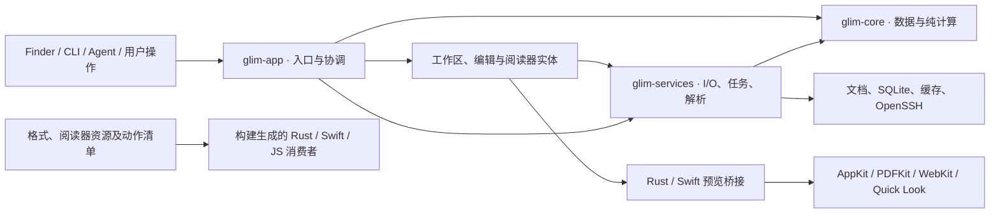

# 架构治理

[架构与数据流](architecture.zh-CN.md) · [阅读器模块契约](reader-modules.zh-CN.md) · [工程待办与验收缺口](TODO.zh-CN.md)

本页记录各子系统的权威入口、仍须防守的契约和已验证的治理任务。具体实现以源码为准，架构正文保留跨模块数据流，已有阅读器和性能待办继续在工程待办中维护。

## 架构与状态归属

| 子系统 | 运行期所有者 | 数据和对外边界 |
| --- | --- | --- |
| 文件类型和能力 | [文档提供者](../crates/glim-services/src/documents/registry.rs)准备内容，[阅读器装配](../crates/glim-app/src/views/reader/construction.rs)选择视图 | [格式目录](../assets/format-catalog.json)生成扩展名、图标、系统关联和格式文档 |
| 窗口与工作区 | [窗口实体](../crates/glim-app/src/views/workspace_window.rs)持有工作区，[工作区](../crates/glim-app/src/views/workspace/mod.rs)持有根目录、Explorer 和标签 | [工作区会话模型](../crates/glim-core/src/session.rs)与[存储](../crates/glim-services/src/storage/sessions.rs)负责重启恢复 |
| 文档、编辑与保存 | [文档会话](../crates/glim-app/src/app/document_session.rs)持有身份、路径、快照与可选的[编辑会话](../crates/glim-app/src/app/edit_session.rs)，[保存协调器](../crates/glim-app/src/views/workspace/editing.rs)持有保存任务 | [本地文件](../crates/glim-services/src/files.rs)、[分页](../crates/glim-services/src/paged.rs)和 [SFTP 操作](../crates/glim-services/src/remote/operations.rs)定义各自写回协议，[草稿](../crates/glim-services/src/drafts.rs)管理未命名笔记检查点 |
| 阅读与界面 | [阅读器契约](../crates/glim-app/src/views/reader/contract.rs)和各阅读器实体持有视图状态，[原生预览](../native/EmbeddedPreview.swift)持有系统控制器 | [阅读动作](../assets/reader-actions.json)声明跨语言动作标识，能力条件和执行分别由 [GPUI](../crates/glim-app/src/views/workspace/reader_actions.rs)和 [AppKit](../native/ReaderActions.swift)路由。主题由现有 UI 工具包提供 |
| 搜索与远端连接 | [工作区](../crates/glim-app/src/views/workspace/search.rs)持有查询和取消状态，[远端应用状态](../crates/glim-app/src/app/remote.rs)持有连接会话 | [内容搜索](../crates/glim-services/src/content_search.rs)与[远端索引](../crates/glim-services/src/remote/search_index.rs)保留不同匹配协议，搜索根目录统一由[工作区服务](../crates/glim-services/src/workspace.rs)规范化，SSH 认证由 OpenSSH 托管 |
| 读写与资源 | [工作空间任务调度](../crates/glim-services/src/work/scheduler.rs)分配工作通道，[资源服务](../crates/glim-services/src/resources.rs)提供共享池，[纯资源模型](../crates/glim-core/src/resources.rs)管理预留 | [阅读器策略](../assets/reader-limits.json)是跨语言资源规则来源，文件监听和读写留在服务层，原生预览经资源句柄协调 |
| 配置、存储和集成 | [存储](../crates/glim-services/src/storage.rs)拥有应用数据库、表结构和迁移，[偏好](../crates/glim-services/src/preferences.rs)暴露业务访问，[集成](../crates/glim-services/src/integrations.rs)持有外部配置编辑规则 | 用[数据表](../crates/glim-services/src/storage/schema.sql)区分工作区、偏好、草稿和恢复记录。图表与 SSH 索引使用独立、可重建的缓存。外部集成需保留未知字段、注释和备份 |
| 错误、重试与可观测性 | [文档读取](../crates/glim-services/src/documents/mod.rs)分类文件失败，[诊断](../crates/glim-services/src/diagnostics.rs)拥有日志及文件故障状态，[遥测](../crates/glim-services/src/telemetry.rs)拥有事件和发送队列 | 应用把错误映射为本地化反馈。远端连接和后台索引分别保留退避策略。原生失败经桥接返回 |
| 构建、更新与验证 | [Cargo 工作区](../Cargo.toml)、[构建脚本](../crates/glim-app/build.rs)和[构建流程](../scripts/bundle-macos.sh)定义本机产物，[原生 Sparkle 桥接](../native/Updater.swift)与[更新服务](../crates/glim-services/src/updates.rs)拥有更新和恢复入口 | [发布工作流](../.github/workflows/ci.yml)处理两种 macOS 架构和打包。[架构检查](../scripts/check-architecture.py)、阅读器契约测试和原生夹具防守各自边界 |

## 架构决策

- **搜索根目录属于工作区服务。** 本地文件名、内容搜索及 SSH 对应入口均按路径组件排序、去重和移除被父目录覆盖的子根。路径归一不需要接触磁盘或远端。缓存键的旧字节契约由固定摘要的测试覆盖。
- **多种写回协议保留各自契约。** 普通文件依赖已保存文本，分页保存依赖文件身份及原区间，SSH 写回依赖远端基线与 SFTP 原子重命名。治理收敛到共同语义时，仍须保留各自的冲突处理与恢复路径。
- **先执行已有边界检查。** 在 main 推送与 PR 上执行仓库已有的架构和本地化检查，复用同一命令，并保留为实际装配过程设置的功能验证。

- **原生预览请求保留两端的类型检查。** Rust 构造并编码，Swift 解码并拒绝非法输入。两端以同一个 [协议样例](../native/tests/fixtures/preview-requests.json) 为兼容基线。

## 进度与优化任务池

| 状态 | 任务 | 验收条件 |
| --- | --- | --- |
| 已迁移 | 搜索根目录存在三份等价规则 | 所有搜索入口复用工作区规则，SSH 索引沿用现有缓存键 |
| 已接入 | 架构和本地化检查缺少普通分支 CI 入口 | PR 与 main push 使用现有脚本验证依赖方向、注册、生成目录和中英文消息 |
| 已接入 | 工作区准备结果检查遗漏子模块 | 对整个工作区视图模块树使用同一规则 |
| 已迁移 | CSV、地理表格、JSON 和 OpenAPI 重复比较文本快照 | `TextSnapshot` 统一按文本值比较，资源预留与各阅读器的重新准备条件归各自所有者 |
| 已迁移 | 本地目录树和两种搜索重复定义遍历可见性 | 统一隐藏、忽略、.git 和目录软链接规则。契约测试保留各入口的结果与排序 |
| 已迁移 | 表格格式、分隔符和名称分散在 CLI 与阅读器 | `TableFormat` 消费格式目录。CLI 和表格适配器复用类型，地理文件仍走地理解析 |
| 已迁移 | App 构建和原生预览测试分别维护 Swift 源文件列表 | [原生预览源清单](../native/preview-sources.txt)由生产库编译、Cargo 重编译跟踪及原生测试共同消费 |
| 已接入 | 资源策略改动可以漏更新中英文生成清单 | 架构检查对两份清单执行只读比对，拒绝缺失或过期版本 |
| 已接入 | Rust 编码与 Swift 解码的兼容检查未在 PR 或主分支运行 | 共用版本化样例，检查所有请求类型与 Swift 端拒绝条件 |
| 已迁移 | 分页保存与删除后另存重复校验和替换字节区间 | 分页服务统一核对文件戳与原字节，用固定缓冲输出替换结果；文件发布、冲突提示与回滚仍由调用方负责 |
| 已迁移 | 界面重复保存分页版本条件、刷新请求和指纹格式 | 继续读、刷新与保存请求由分页模块构造；重新加载维持各自的版本条件，界面保留任务与编辑生命周期 |
| 已迁移 | 程序入口重复解析参数，服务调用方各自复制进程参数 | 应用入口一次分派，生成 Agent 配置与派发渲染进程的服务提供匹配参数。保留各入口的外部命令字节与启动顺序 |
| 已迁移 | 偏好与存储互相依赖，应用数据目录由偏好和更新分别解析 | 存储管理数据目录及最近工作区 SQL，核心层持有值类型。各服务沿用现有数据路径与格式 |
| 待确认 | 大文本跨页编辑与写回解耦 | 明确草稿生命周期、磁盘峰值、外部冲突与崩溃恢复，再决定是否改变现有分页保存行为 |

按 [工程待办](TODO.zh-CN.md) 跟踪剩余阅读器模块、资源准入和实机验收。在共享配置发生变更时，优先由其既有生成器和对应契约验证所有消费方。
