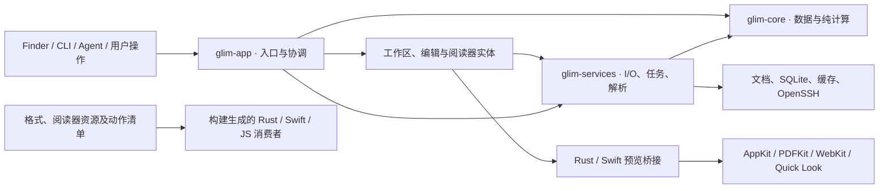

# 架构治理

[架构与数据流](architecture.zh-CN.md) · [阅读器模块契约](reader-modules.zh-CN.md) · [工程待办与验收缺口](TODO.zh-CN.md)

本页记录各子系统的权威入口、仍须防守的契约和已验证的治理任务。具体实现以源码为准，架构正文保留跨模块数据流，已有阅读器和性能待办继续在工程待办中维护。

## 架构与状态归属

| 子系统 | 运行期所有者 | 数据和对外边界 |
| --- | --- | --- |
| 文件类型和能力 | [文档提供者](../crates/glim-services/src/documents/registry.rs)准备内容，[阅读器装配](../crates/glim-app/src/views/reader/construction.rs)选择视图 | [格式目录](../assets/format-catalog.json)生成扩展名、图标、系统关联和格式文档 |
| 窗口与工作区 | [窗口实体](../crates/glim-app/src/views/workspace_window.rs)持有工作区，[工作区](../crates/glim-app/src/views/workspace/mod.rs)持有根目录、Explorer 和标签 | [工作区会话模型](../crates/glim-core/src/session.rs)与[存储](../crates/glim-services/src/storage/sessions.rs)负责重启恢复 |
| 文档、编辑与保存 | [文档会话](../crates/glim-app/src/app/document_session.rs)持有身份、路径、快照与可选的[编辑会话](../crates/glim-app/src/app/edit_session.rs)，[保存协调器](../crates/glim-app/src/views/workspace/editing.rs)持有保存任务 | [本地文件](../crates/glim-services/src/files.rs)、[分页](../crates/glim-services/src/paged.rs)和 [SFTP 操作](../crates/glim-services/src/remote/operations.rs)定义各自写回协议，[草稿](../crates/glim-services/src/drafts.rs)管理未命名笔记检查点 |
| 阅读与界面 | [阅读器契约](../crates/glim-app/src/views/reader/contract.rs)和各阅读器实体持有视图状态，[原生预览](../native/EmbeddedPreview.swift)持有系统控制器 | [阅读动作](../assets/reader-actions.json)声明跨语言动作标识，能力条件和执行分别由 [GPUI](../crates/glim-app/src/views/workspace/reader_actions.rs)和 [AppKit](../native/ReaderActions.swift)路由。主题由现有 UI 工具包提供 |
| 搜索与远端连接 | [工作区](../crates/glim-app/src/views/workspace/search.rs)持有查询和取消状态，[远端应用状态](../crates/glim-app/src/app/remote.rs)持有连接会话 | [内容搜索](../crates/glim-services/src/content_search.rs)与[远端索引](../crates/glim-services/src/remote/search_index.rs)保留不同匹配协议，搜索根目录统一由[工作区服务](../crates/glim-services/src/workspace.rs)规范化，SSH 认证由 OpenSSH 托管 |
| 读写与资源 | [工作空间任务调度](../crates/glim-services/src/work/scheduler.rs)分配工作通道，[资源服务](../crates/glim-services/src/resources.rs)提供共享池，[纯资源模型](../crates/glim-core/src/resources.rs)管理预留 | [阅读器策略](../assets/reader-limits.json)是跨语言资源规则来源，文件监听和读写留在服务层，原生预览经资源句柄协调 |
| 配置、存储和集成 | [存储](../crates/glim-services/src/storage.rs)拥有应用数据库、表结构和迁移，[偏好](../crates/glim-services/src/preferences.rs)暴露业务访问，[集成](../crates/glim-services/src/integrations.rs)持有外部配置编辑规则 | 用[数据表](../crates/glim-services/src/storage/schema.sql)区分工作区、偏好、草稿和恢复记录。图表与 SSH 索引使用独立、可重建的缓存。外部集成需保留未知字段、注释和备份 |
| 错误、重试与可观测性 | [文档读取](../crates/glim-services/src/documents/mod.rs)分类文件失败，[诊断](../crates/glim-services/src/diagnostics.rs)拥有日志及文件故障状态，[遥测](../crates/glim-services/src/telemetry.rs)拥有事件和发送队列 | 应用把错误映射为本地化反馈。远端连接和后台索引分别保留退避策略。原生失败经桥接返回 |
| 构建、更新与验证 | [Cargo 工作区](../Cargo.toml)、[构建脚本](../crates/glim-app/build.rs)和[构建流程](../scripts/bundle-macos.sh)定义本机产物，[原生 Sparkle 桥接](../native/Updater.swift)与[更新服务](../crates/glim-services/src/updates.rs)拥有更新和恢复入口 | [发布工作流](../.github/workflows/ci.yml)处理两种 macOS 架构和打包。[架构检查](../scripts/check-architecture.py)、阅读器契约测试和原生夹具防守各自边界 |

## 技术方案与保留边界

| 技术 | 使用位置 | 依赖与变更证据 |
| --- | --- | --- |
| Rust、GPUI Kit、Tree-sitter | 窗口、文本编辑、语法查询、纯模型与后台服务 | [Cargo 工作区](../Cargo.toml)固定依赖和本地补丁。升级 GPUI 前核对编辑器、Markdown 任务回写及原生窗口回调实际调用的补丁接口 |
| Swift、AppKit 与 macOS 框架 | PDFKit 阅读、AVKit 音视频、WebKit 网页及打印、Quick Look 原生版式、FinderSync 文件入口 | [原生预览清单](../native/preview-sources.txt)覆盖内嵌库生产源。FinderSync 扩展使用[独立构建脚本](../scripts/bundle-finder.py)。[预览请求](../native/PreviewRequest.swift)验证带类型的载荷 |
| Markdown AST、TextView、HTML 导出 | 原文范围与图表资源提取使用 `markdown`，查看器用 GPUI TextView 渲染，独立导出使用 `pulldown-cmark` | [预览准备](../crates/glim-services/src/markdown_preview.rs)拥有空行表格修复、图表识别及公式类型。[排版](../vendor/gpui-base/src/text/format/markdown.rs)处理源码范围和任务回写，[导出](../crates/glim-services/src/markdown_export.rs)逐事件生成 HTML 并独立处理链接和资源 |
| quick-xml 与 roxmltree | 前者流式处理可分页或超大的 XML 投影，后者用于已读取的电子书目录及 draw.io 结构 | [流式地理数据](../crates/glim-services/src/geo.rs)、[书籍](../crates/glim-services/src/books/mod.rs)、[draw.io](../crates/glim-services/src/drawio.rs)。调整解析器需证明峰值内存及错误恢复 |
| SQLite | 应用状态库、可重建缓存、远端路径索引、用户数据库只读浏览 | 状态库保护恢复与偏好，缓存允许回收，用户数据库依赖私有快照。参见[状态库](../crates/glim-services/src/storage.rs)、[缓存存储](../crates/glim-services/src/storage/cache.rs)和[数据库浏览](../crates/glim-services/src/sqlite/browser.rs) |
| OpenSSH、SFTP、Git | OpenSSH 负责认证、主机信任和配置。SFTP 提供传输及目录操作，Git 命令负责仓库协议 | [连接构造](../crates/glim-services/src/remote.rs)区分交互与批处理，[SFTP](../crates/glim-services/src/remote/sftp.rs)拥有协议、取消及子进程 |
| JSON、JSONC、TOML | 版本化桥接、SQLite 记录和外部应用配置 | [集成编辑器](../crates/glim-services/src/integrations.rs)必须保留未知字段和可保留的注释，协议和持久化数据由各自类型验证 |
| 离线图表、日志与遥测 | 内嵌图表资源通过 WebKit 辅助进程运行。日志保存在本地，遥测通过队列使用 Aptabase | [图表资源](../assets/markdown/README.md)、[本地日志](../crates/glim-services/src/diagnostics.rs)和[遥测政策](telemetry.zh-CN.md)各自声明输入与输出 |
| 原生 Cargo、Swift、Python 与 Sparkle | Rust 工作区及生成脚本编译，Swift 提供静态库，签名与 Sparkle 由 macOS 打包流程处理 | [构建与发布](releasing.zh-CN.md)及[更新实现](auto-update-design.zh-CN.md)约束版本映射、签名和双架构产物 |

## 公理设计分析

先分析文档工作区的一轮完整使用。按独立公理，以用户可观察的功能为 FR，以当前能改变该功能的实现决策为 DP。同一编号是主要对应关系。`X` 表示源码证实该 DP 直接约束行功能的结果或可用性，`·` 表示在这组需求及入口下未纳入直接影响。该矩阵基于调用路径的定性判断。macOS 双架构、数据兼容和文件大小策略是约束。SSH 连接、设置与集成、更新和诊断仍有各自的功能需求，下面的矩阵只包含文档工作流。

| 行 | 功能需求 FR | 列 | 设计参数 DP |
| --- | --- | --- | --- |
| FR1 | 打开、切换、关闭和跨窗口移动文档，保护未保存内容 | DP1 | 工作区拥有标签、活动选择和移动编排 |
| FR2 | 在恰当的阅读器查看文档并切换原文与预览 | DP2 | 阅读器装配、视图生命周期和显示模式 |
| FR3 | 编辑 UTF-8 文本、撤销、保存并处理写回冲突 | DP3 | 编辑会话、保存协调及写回版本契约 |
| FR4 | 查找文件和内容，并定位到命中处 | DP4 | 工作区搜索、文档查找及结果导航 |
| FR5 | 重启后恢复本地工作区、标签和阅读模式 | DP5 | 工作区会话快照、串行写入和恢复调度 |
| FR6 | 将当前 Markdown 导出为 HTML 或 PDF | DP6 | Markdown 导出服务及资源封装 |

| FR ∖ DP | DP1 | DP2 | DP3 | DP4 | DP5 | DP6 |
| --- | :-: | :-: | :-: | :-: | :-: | :-: |
| FR1 | X | X | X | · | X | · |
| FR2 | X | X | X | · | · | · |
| FR3 | X | X | X | · | · | · |
| FR4 | X | X | X | X | · | · |
| FR5 | X | X | X | · | X | · |
| FR6 | X | X | X | · | · | X |

- `FR1 × DP2` 来自标签移动前的阅读器能力检查。`FR1 × DP3` 来自写入进行中的移动阻塞和关闭时的未保存保护。会话恢复期间也会阻止移动，因此 `FR1 × DP5` 非零。[标签生命周期](../crates/glim-app/src/views/workspace/tabs.rs) · [恢复会话](../crates/glim-app/src/views/workspace/session.rs)
- `FR2 × DP1` 来自活动页对阅读器的激活与隐藏。`FR2 × DP3` 来自脏分页打开预览前的保存门槛。`FR3 × DP1` 来自工作区选择的活动编辑器和各工作区保存队列。`FR3 × DP2` 源于分页视图是否构造可编辑原文。[工作区呈现](../crates/glim-app/src/views/workspace/render.rs) · [预览切换](../crates/glim-app/src/views/reader/text.rs) · [保存协调](../crates/glim-app/src/views/workspace/editing.rs) · [分页阅读器](../crates/glim-app/src/views/reader/paged.rs)
- 查找结果通过工作区打开目标，依阅读器类型切换到原文或文档内查找，并在编辑器或分页视图中定位。会话快照从工作区与阅读器读取活动项和显示模式。首次保存会将草稿转换为可恢复的文件标签。GUI 导出受活动标签、预览能力与当前编辑文本共同控制，CLI 从文档路径取得输入。[搜索跳转](../crates/glim-app/src/views/workspace/search.rs) · [会话快照](../crates/glim-app/src/views/workspace/session.rs) · [首次保存](../crates/glim-app/src/views/reader/editing.rs) · [导出动作](../crates/glim-app/src/views/workspace/reader_actions.rs)

矩阵存在上三角项。`FR1 × DP3` 与 `FR3 × DP1` 双向非零。只要保留 FR 与主 DP 的匹配，交换编号也无法把这个子块排成下三角。现阶段仍是耦合设计。独立公理的改进方向是让文档会话公开保存与迁移所需的窄契约，工作区继续编排用户操作，阅读器继续拥有显示资源。关闭前的脏状态保护属于真实需求，矩阵应持续保留这项影响。信息公理需要各需求的验收区间和完成概率，目前缺少实机及压力数据，暂不计算信息量。

Markdown 图表子问题已完成一次迁移。预览和导出共享图表与公式识别，以及表格修复使用的 AST 预处理。预览的原文选择与回写由 TextView 管理，导出的事件和资源由独立流水线管理。共享样例验证了两条链产生的图表数据及导出事件，尚缺实际预览像素与 PDF 输出的对照。可以沿这一边界继续减少重复规则，无需据此推断完整 Markdown 流程已经解耦。

## 架构决策

- **搜索根目录属于工作区服务。** 本地文件名、内容搜索及 SSH 对应入口均按路径组件排序、去重和移除被父目录覆盖的子根。路径归一不需要接触磁盘或远端。缓存键的旧字节契约由固定摘要的测试覆盖。
- **多种写回协议保留各自契约。** 普通文件依赖已保存文本，分页保存依赖文件身份及原区间，SSH 写回依赖远端基线与 SFTP 原子重命名。治理收敛到共同语义时，仍须保留各自的冲突处理与恢复路径。
- **先执行已有边界检查。** 在 main 推送与 PR 上执行仓库已有的架构和本地化检查，复用同一命令，并保留为实际装配过程设置的功能验证。
- **原生预览请求保留两端的类型检查。** Rust 构造并编码，Swift 解码并拒绝非法输入。两端以同一个 [协议样例](../native/tests/fixtures/preview-requests.json) 为兼容基线。
- **Markdown 共用图表语义，保留两条解析链。** 预览依赖 AST 源码位置，导出依赖 HTML 事件及资源处理。图表别名、公式类型和独立的 `\[ … \]` 段落由服务统一识别。两条链对 `$$` 块的边缘换行有不同的解析结果，契约测试保留各自产出的公式原文。

## 进度与优化任务池

| 状态 | 任务 | 验收条件 |
| --- | --- | --- |
| 已迁移 | 搜索根目录存在三份等价规则 | 所有搜索入口复用工作区规则，SSH 索引沿用现有缓存键 |
| 已接入 | 架构和本地化检查缺少普通分支 CI 入口 | PR 与 main push 使用现有脚本验证依赖方向、注册、生成目录和中英文消息 |
| 已接入 | 工作区准备结果检查遗漏子模块 | 对整个工作区视图模块树使用同一规则 |
| 已迁移 | CSV、地理表格、JSON 和 OpenAPI 重复比较文本快照 | `TextSnapshot` 统一按文本值比较，资源预留与各阅读器的重新准备条件归各自所有者 |
| 已迁移 | 本地目录树和两种搜索重复定义遍历可见性 | 统一隐藏、忽略、.git 和目录软链接规则。契约测试保留各入口的结果与排序 |
| 已迁移 | 表格格式、分隔符和名称分散在 CLI 与阅读器 | `TableFormat` 消费格式目录。CLI 和表格适配器复用类型，地理文件仍走地理解析 |
| 已迁移 | App 构建和原生预览测试分别维护 Swift 源文件列表 | [原生预览源清单](../native/preview-sources.txt)由生产库编译、Cargo 重编译跟踪及原生测试共同消费 |
| 已接入 | 资源策略改动可以漏更新中英文生成清单 | 架构检查对两份清单执行只读比对，拒绝缺失或过期版本 |
| 已接入 | Rust 编码与 Swift 解码的兼容检查未在 PR 或主分支运行 | 共用版本化样例，检查所有请求类型与 Swift 端拒绝条件 |
| 已迁移 | 分页保存与删除后另存重复校验和替换字节区间 | 分页服务统一核对文件戳与原字节，用固定缓冲输出替换结果；文件发布、冲突提示与回滚仍由调用方负责 |
| 已迁移 | 界面重复保存分页版本条件、刷新请求和指纹格式 | 继续读、刷新与保存请求由分页模块构造；重新加载维持各自的版本条件，界面保留任务与编辑生命周期 |
| 已迁移 | 程序入口重复解析参数，服务调用方各自复制进程参数 | 应用入口一次分派，生成 Agent 配置与派发渲染进程的服务提供匹配参数。保留各入口的外部命令字节与启动顺序 |
| 已迁移 | 偏好与存储互相依赖，应用数据目录由偏好和更新分别解析 | 存储管理数据目录及最近工作区 SQL，核心层持有值类型。各服务沿用现有数据路径与格式 |
| 已迁移 | 书籍阅读设置在界面与持久化层分别定义，旧数据迁移反向依赖书籍偏好 | 核心阅读状态拥有取值校验和控件变化规则，界面、持久化和旧数据迁移共用 |
| 已迁移 | 通用存储初始化反向调用图表缓存迁移 | 服务启动按原顺序完成数据库初始化与图表缓存导入，存储只负责通用持久化 |
| 已迁移 | SSH 路径索引、全文搜索、Git 和 SFTP 各自拼接非交互认证参数 | 连接构造器统一认证模式，三个远端 Shell 入口共用按原始字节引用参数的规则 |
| 已迁移 | 外部打开与标签定位散落在应用入口，重复解析同一个 URL | 文件打开模块拥有路由和标签复用，保持远端、Finder 和普通文件的分派顺序 |
| 已迁移 | 应用入口与测试直接修改全局工作区注册列表 | 注册与关闭通过工作区注册表，调用方按原需求读取已注册列表或可用窗口 |
| 已迁移 | 外部打开 GPUI 测试在多个模拟执行器间争用同一个文档任务调度器 | 每个测试应用使用独立调度器，生产路径保持进程级任务配额 |
| 已迁移 | 排队打开与直接打开维护同一套文件和文稿包识别逻辑 | 两条本地打开路径共用后台准备，保留各自的任务顺序和结果发布 |
| 已迁移 | 通用偏好模块维护遥测同意的专用兼容规则 | 遥测同意类型拥有读取和写入，两套存储键保留原有向后兼容和失败行为 |
| 已迁移 | 启动、更新和窗口实体直接修改会话全局状态，两个写入队列重复编排 | 会话模块封装恢复、快照读取和待写任务，两个存储域各自维持原有顺序 |
| 已迁移 | 本地恢复目录与最近列表原先分开读写 | 保存和恢复各使用一致的 SQLite 快照。远端仅更新最近列表，任一写入失败会回滚 |
| 已迁移 | 阅读模式使用字符串分派，默认值和持久化键分散在界面与服务 | 阅读模式类型统一选择持久化键、默认值和运行期状态，旧偏好及格式映射保持兼容 |
| 已迁移 | Markdown 查看和导出各自识别公式段落，AST 消费者重复配置解析选项 | 共用公式规则及 AST 选项。CI 用同一份源文验证表格、公式、图表、普通代码和前言的处理 |
| 已迁移 | 分页 HTML 的显示模式分散在生命周期、渲染和查找分支 | 分页 HTML 适配器拥有模式，激活与隐藏共用状态转换。定向测试固定原文编辑器身份、草稿及返回预览的保存门槛 |
| 已迁移 | 压缩包子目录每次在界面端扫描全部条目 | 压缩包服务按现有路径排序定位子目录范围，提供即时子项、总大小及稳定顺序。CLI 继续使用完整目录 |
| 已迁移 | 工作区搜索分别持有结果路径及内容命中，删除文件会使两份下标错位 | 文件名结果与内容命中使用同一种结果行，绘制与打开共享数据。删除保留其他行的偏移，影响搜索范围的移动清除旧定位 |
| 已迁移 | 本地文件监听与 SSH 轮询重复发布刷新结果和替换阅读器 | 共用原位更新、身份继承和替换流程。两个监听器各自处理远端文件版本、本地快照、就绪条件和失败反馈 |
| 已迁移 | 原生预览与内嵌图片分别生成和比较源文件元数据 | 媒体服务统一提供大小和修改时间组成的源文件戳。刷新请求复用准备结果的类型，写回冲突仍使用各自的版本契约 |
| 已迁移 | 图表和远程图片缓存读取时先复制 SQLite 的完整 BLOB | 存储统一负责限长与校验，消费方在查询期间借用字节。图表迁移仍逐项读回比对，缓存键和持久化格式不变 |
| 已迁移 | 多种结构化预览在读取结束时释放输入预留，解析期间仍持有原缓冲 | OPML、XMind、向量、Draw.io 和从文件读取的交互图持有输入预留直到消费完成。向量预览压力不足时进入原文分页。Draw.io 在已预留的缓冲中原位解码 XML，Base64、解析器和栅格化的中间分配仍待单独测量 |
| 已迁移 | 图表、Draw.io 和向量预览分别分配 SVG 画布 | 媒体服务统一为实际画布和 tiny-skia 编码副本准入。内置图片失败占位图保留原路径，内存压力下仍有反馈 |
| 已接入 | 目录聚合、图像刷新、派生缓存和像素准入缺少日常 CI 回归 | 架构工作流运行对应的服务契约，包括图表缓存旧数据迁移和读取预留的最终释放 |
| 已迁移 | 普通文本和 XMind 的旧测试将无限制哨兵当作夹具大小 | 去掉不可执行的分配。无效输入仍由格式测试覆盖，架构 CI 验证跨输入缓冲的 UTF-8 字符完整性 |
| 已迁移 | 原生缩略图解码预留与显示记账在交付时重复占用同一批像素 | 解码与显示共用数字租约，交付时按实际行跨度和高度调整。Swift 契约覆盖缩减、扩容失败和被取消的消费者继续持有租约 |
| 已迁移 | OpenAPI 查询估算只记账到查询返回，响应排队交付期间没有所有者 | 查询前申请估算工作预算，查询完成后按响应字节缩减并持有至 WebKit 交付。预算不足使用原有重试，SQLite 与 WebKit 内部仍需单独测量 |
| 已迁移 | 原生 HTML 顺序交付编辑器快照时逐块复制已有 `Data` | 快照持有自己的字节租约，切片借用底层存储。文件读取保持单块同步交付，工作线程跟踪固定读取缓冲 |
| 已迁移 | 打包先独立复制两份可执行文件，挤占签名临时空间 | 文件系统支持时克隆两份独立文件，克隆失败时脚本回退到普通复制。签名仍需要临时空间，应用与辅助程序分别校验 |
| 已迁移 | 标签菜单、拖出窗口和外部打开分别检查工作区的转移条件 | 三处共用保存、加载、确认和更新状态的门槛。外部打开额外保护进行中的文件队列 |
| 已覆盖 | 跨窗口交接缺少未保存草稿的所有权检查 | GPUI 定向测试验证同一编辑器、草稿路径和恢复键转交。源窗口释放订阅，目标窗口能撤销原编辑 |
| 已迁移 | 静态多页预览每次绘制都遍历所有页面执行挂起 | 切换时只挂起上一张实际绘制的页面。隐藏定位到实际绘制页，即使选中页已经改变且下一帧尚未绘制 |
| 已接入 | GPUI 标签与分页生命周期只在本地定向验证 | macOS 架构工作流验证草稿交接、静态预览挂起、分页 HTML 编辑保护与取消恢复。用 GPUI 测试执行器驱动状态迁移 |
| 已迁移 | JSON 格式化先复制完整字符缓冲，再重复识别引号和转义 | 验证后直接生成格式化结果。CI 固定重复键、数字字面量、字符串和空容器的输出 |
| 待测量 | Markdown 预览与导出解析链仍有不同的链接、任务和源码位置契约 | 对照两个入口的契约，再判断可共享的规则及解析成本 |
| 待验证 | 原生、分页及媒体阅读器仍持有服务和展示的混合职责 | 沿阅读器契约逐个验证加载、隐藏、刷新和跨窗口转移，再提取真实独立的数据准备 |
| 待测量 | 缓存及解析器共享资源预算仍有框架内存盲区 | 先测量各阶段峰值及真实缓存收益，再治理可控工作缓冲 |
| 待确认 | 大文本跨页编辑与写回解耦 | 明确草稿生命周期、磁盘峰值、外部冲突与崩溃恢复，再决定是否改变现有分页保存行为 |

按 [工程待办](TODO.zh-CN.md) 跟踪剩余阅读器模块、资源准入和实机验收。在共享配置发生变更时，优先由其既有生成器和对应契约验证所有消费方。
