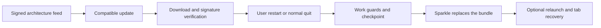

# Application updates

**English** · [简体中文](auto-update-design.zh-CN.md) · [Documentation](README.md)

## Current implementation

macOS release builds use **GitHub Releases + Sparkle 2.10.0 + Glim's shared update window**. The updater was introduced in 0.1.12. Unconfigured local builds offer manual GitHub downloads. Updates are published only for Apple Silicon and Intel Macs. Sparkle is the sole update backend; existing public releases are retained.

This page describes implemented behavior and remaining boundaries, not a promise of future features or release dates. Deployment commands and secrets belong in [build and release](releasing.md#automatic-updates).

## User behavior

Open updates from the Glim menu, About or the workspace update indicator. All workspace windows share one `UpdateState`; reopening activates the existing centered update window. A user-initiated check opens this window immediately, including while preparing the backup, checking, reporting no update or reporting an error. Background checks do not open it.

| Mode | Check | Download | Install |
| --- | --- | --- | --- |
| Manual | User action | User approval | Restart and Update or Install on Quit |
| Notify | At launch after backup preparation, then approximately hourly while running | User approval | Same choices |
| Automatic — default | Same schedule | Background verified download | Normal quit, or an explicit restart |

The UI shows version, release notes, status/progress, reminders, skip/cancel actions and recovery backup access as applicable. Modes are stored through Sparkle's preferences API. Automatic mode does not authorize interruption of editing, forced process termination or automatic entry of administrator credentials. No permanent updater daemon runs after the app quits.

## Release URLs and version identity

Each architecture has a stable signed feed:

```text
https://github.com/glimapp/glim/releases/latest/download/appcast-macos-arm64.xml
https://github.com/glimapp/glim/releases/latest/download/appcast-macos-x86_64.xml
```

Enclosures point to a specific tag's `Glim-<version>-macos-<arch>.dmg`, not a mutable latest installer. Display versions use `CFBundleShortVersionString`; Sparkle ordering uses strictly increasing `CFBundleVersion`. The bundle identifier remains `io.github.jony4.glimpse`. Clients need no GitHub token or GitHub Releases API query.

## Trust and signing

Feed and update archive must pass Ed25519 verification. A public key is embedded in the release bundle; the private 32-byte seed belongs only in the protected release environment and offline/keychain backups. The fixed Sparkle archive is SHA-256 checked before use.

| Bundle setting | Policy |
| --- | --- |
| `SUFeedURL` / `SUPublicEDKey` | Allowed production architecture feed and fixed update key |
| `SUEnableAutomaticChecks` / `SUScheduledCheckInterval` | Enabled by default / 3600 seconds |
| `SUAutomaticallyUpdate` | True by default; existing user preferences are preserved |
| `SUEnableSystemProfiling` | False |
| `SUVerifyUpdateBeforeExtraction` | True |
| `SURequireSignedFeed` | True |
| `SUSignedFeedFailureExpirationInterval` | 0; prolonged failures never relax verification |

Release notes are embedded in the signed feed. SHA-256 files provide integrity checks for manual downloads and CI, not publisher authentication on their own. Sparkle signatures are separate from Apple Developer ID signing/notarization; current apps are ad-hoc signed. There is no unsigned-update bypass or automatic quarantine/security disabling.

Loss of the signing key does not create a safe online replacement key automatically. Without an implemented trusted migration, users need a manual installation to establish a new key. Preserve the existing release key.

## Install approval and work protection



`app/updates` is the shared coordinator. Before approving an install/quit continuation it checks all registered workspaces for unsaved changes, saves and file loading; freezes editing and file writes; waits for pending preference writes; rechecks the backup; and persists a bounded session checkpoint. Failure keeps the old app and restores interaction. A new Finder open invalidates the pending exit generation and retains the file request.

`SPUUserDriver` handles native status/choices; Rust owns work approval. The bridge adds the missing `applicationShouldTerminate:` method to the fixed GPUI delegate without replacing its identity or lifecycle methods. An incompatible existing termination contract disables the updater. Non-cancellable final quit cleanup is not used as an approval gate.

Sparkle owns extraction, installation, permission prompts, bundle replacement and relaunch. Running other copies, a DMG/read-only/translocated location, an unavailable backup or canceled authorization can prevent installation. The application does not force-close other copies or silently change the installation location.

## Backup and one-time recovery

A complete signed bundle backup is prepared in the background before update activity starts. The backup is a content-fingerprint-named ZIP plus a SHA-256 receipt under `~/Library/Application Support/Glim/UpdateBackups/`. The signature is checked before copying and the receipt checked again before install approval. User documents and preferences are not part of the app backup. Existing matching verified backups are reusable. Preparation is serialized with an OS lock and retains only one verified archive/receipt pair, pruning previous app-owned archives only after a replacement is complete and verified.

The one-time session stores workspace roots, file/playlist tabs, order, active tab and supported preview modes. It contains no unsaved document text. Restored media is paused; document scroll positions and media timestamps are not a complete persistent session feature.

A checkpoint is consumed once on next startup, including when a failed installation left the original build running or a manual install skipped ahead. Explicit cancellation clears it; corrupt checkpoints are quarantined rather than retried forever. Normal launches without an update checkpoint restore saved window/workspace groups and file tabs from the application database.

## Failure boundaries and remaining work

| Situation | Current behavior |
| --- | --- |
| Offline, timeout or missing feed | Keep the current app; manual checks show an error and can retry |
| Invalid signature, damaged/incompatible package | Refuse installation |
| Canceled download/update | Preserve app/work; native cancellation clears the pending transaction as applicable |
| Backup/checkpoint failure or active work | Block restart/install and show the reason |
| Permission/replacement failure | Use Sparkle's result, retain backup and manual download access |
| New app crashes | Manual recovery from a retained backup; no automatic health-based rollback |

Real Intel/admin-directory acceptance coverage, Apple notarization, key migration, beta channels, delta updates and a health-based recovery assistant remain separate work. Existing isolated tests do not substitute for every production hardware/permissions scenario.

## Implementation references

- `glim-core/src/update.rs`: snapshots, modes, activity guards and session values.
- `glim-services/src/updates.rs`: backup verification and transactional one-time SQLite session records.
- `glim-app/src/app/updates.rs`: global state, tasks, locks and install/quit approval.
- `app/updater_bridge.rs` / `native/Updater.swift`: main-thread FFI and Sparkle custom driver/delegate.
- `views/updates.rs` / `workspace/session.rs`: shared UI and restored readers.
- `scripts/create-update-feeds.py` / `.github/workflows/release.yml`: verified signed release drafts with compatible history and upload roundtrip checks.

See [architecture](architecture.md), [release checks](releasing.md#isolated-updater-validation) and [roadmap](TODO.md).

Official references: [Sparkle 2.10.0](https://github.com/sparkle-project/Sparkle/releases/tag/2.10.0), [signing](https://sparkle-project.org/documentation/), [publishing](https://sparkle-project.org/documentation/publishing/), [programmatic setup](https://sparkle-project.org/documentation/programmatic-setup/), [user driver](https://sparkle-project.org/documentation/api-reference/Protocols/SPUUserDriver.html) and [updater delegate](https://sparkle-project.org/documentation/api-reference/Protocols/SPUUpdaterDelegate.html).
