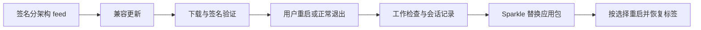

# 应用更新

[English](auto-update-design.md) · **简体中文** · [文档目录](README.zh-CN.md)

## 当前实现

macOS 发行构建使用 **GitHub Releases + Sparkle 2.10.0 + Glim 共用更新窗口**，从 0.1.12 开始提供更新器。未配置的本地构建提供 GitHub 手动下载。当前仅为 Apple Silicon 与 Intel Mac 发布更新。Sparkle 是唯一更新后端，既有公开版本保留。

本文描述已实现行为及剩余边界，不承诺未来功能或发布日期。部署命令与密钥配置见[构建与发布](releasing.zh-CN.md#automatic-updates)。

## 用户行为

通过 Glim 菜单、关于页或工作台更新提示进入。所有工作空间共用一个 `UpdateState`，重复打开激活已有居中更新窗口。用户主动检查时立即打开该窗口，包含准备备份、检查中、没有更新及错误状态；后台检查不弹出此窗口。

| 模式 | 检查 | 下载 | 安装 |
| --- | --- | --- | --- |
| 仅手动 | 用户操作 | 用户确认 | 重启并更新，或退出时安装 |
| 检查提醒 | 启动完成备份准备后检查，持续运行时约每小时 | 用户确认 | 同上 |
| 自动更新 — 默认 | 同样周期 | 后台下载并验证 | 正常退出，或明确选择重启 |

界面按状态展示版本、更新说明、进度、提醒／跳过／取消及恢复备份入口。模式通过 Sparkle 偏好 API 保存。自动更新不代表允许打断编辑、强制终止进程或自动输入管理员凭据；退出后不运行永久更新守护进程。

## 发布地址与版本身份

每个架构有稳定的签名 feed：

```text
https://github.com/glimapp/glim/releases/latest/download/appcast-macos-arm64.xml
https://github.com/glimapp/glim/releases/latest/download/appcast-macos-x86_64.xml
```

安装条目指向具体 tag 的 `Glim-<version>-macos-<arch>.dmg`，不使用可变 latest 安装包。显示版本是 `CFBundleShortVersionString`，Sparkle 排序使用严格递增的 `CFBundleVersion`。保留 `io.github.jony4.glimpse` 身份；客户端不需要 GitHub Token 或 Releases API 查询。

## 信任与签名

feed 与安装包都必须通过 Ed25519 验签。公钥内嵌于发行包，32 字节私钥 seed 仅用于受保护的发布环境及离线／钥匙串备份；固定 Sparkle SDK 下载先核对 SHA-256。

| 包配置 | 策略 |
| --- | --- |
| `SUFeedURL` / `SUPublicEDKey` | 允许的分架构正式 feed 与固定更新公钥 |
| `SUEnableAutomaticChecks` / `SUScheduledCheckInterval` | 默认开启／3600 秒 |
| `SUAutomaticallyUpdate` | 默认 true，保留用户已有选择 |
| `SUEnableSystemProfiling` | false |
| `SUVerifyUpdateBeforeExtraction` | true |
| `SURequireSignedFeed` | true |
| `SUSignedFeedFailureExpirationInterval` | 0，长期失败不放宽验证 |

更新说明内嵌于签名 feed。SHA-256 文件用于手动下载及 CI 的完整性检查，单独不能认证发布者。Sparkle 签名与 Apple Developer ID／公证不同，当前应用使用 ad-hoc 签名；没有忽略签名的更新入口，也不自动移除 quarantine 或关闭安全保护。

私钥遗失不意味着可以安全地在线换钥；没有已实现的可信迁移方案时，用户需要手动安装一次以建立新公钥信任。后续发布应保留原有密钥。

## 安装批准与工作保护



`app/updates` 是共用协调器。批准安装／退出 continuation 前，检查所有已登记工作空间的未保存内容、保存与文件加载；锁定编辑／文件写入，等待偏好写入，重新检查备份并保存有界会话。失败时保留旧 app、恢复交互。新的 Finder 打开请求使退出世代失效，并保留该文件请求。

`SPUUserDriver` 负责原生状态／选择，Rust 负责工作批准。桥接为固定 GPUI delegate 增加缺少的 `applicationShouldTerminate:`，不替换其身份或生命周期方法；已有不兼容退出契约时禁用更新。不可取消的最终退出清理不用作批准入口。

Sparkle 负责解包、安装、授权提示、整包替换与重启。其他运行副本、DMG／只读／translocation 位置、缺失备份或取消授权均可能阻止安装；应用不强制关闭其他副本，也不静默改变安装位置。

## 备份与一次性恢复

更新活动开始前，在后台准备完整已签名应用包的备份。备份位于 `~/Library/Application Support/Glim/UpdateBackups/`，是按内容指纹命名的 ZIP 及 SHA-256 receipt。复制前检查签名，批准安装前再次检查摘要；用户文档和偏好不属于 app 备份。已有匹配且验证通过的备份可复用，历史不自动清理。

一次性会话包含工作空间根目录、文件／播放列表标签、顺序、活动标签及支持的预览模式，不包含未保存正文。恢复的媒体暂停；文档滚动位置与媒体时间戳还不是完整持久会话功能。

检查点在下次启动消费一次，包括安装失败仍运行原 build、或手动安装跳到更高版本的情况。明确取消会清理检查点，损坏文件被隔离而非无限重试。普通启动没有检查点时仅恢复工作空间目录。

## 失败边界与剩余工作

| 场景 | 当前行为 |
| --- | --- |
| 离线、超时或 feed 缺失 | 保留当前应用，手动检查显示错误并可重试 |
| 签名错误、损坏或不兼容包 | 拒绝安装 |
| 取消下载／更新 | 保留应用和工作内容，按原生取消状态清理待处理事务 |
| 备份／会话写入失败或工作未完成 | 阻止安装重启并显示原因 |
| 权限／替换失败 | 使用 Sparkle 实际结果，保留备份及手动下载入口 |
| 新 app 崩溃 | 使用保留备份手动恢复，不自动按健康检查降级 |

Intel／管理员目录实机验收、Apple 公证、通用会话／草稿恢复、换钥、beta 频道、增量更新及健康恢复助手仍是独立待办。隔离测试不能代替全部正式硬件／权限场景。

## 实现位置

- `glim-core/src/update.rs`：快照、模式、活动检查与会话值。
- `glim-services/src/updates.rs`：备份验证及原子一次性会话文件。
- `glim-app/src/app/updates.rs`：全局状态、任务、锁与安装／退出批准。
- `app/updater_bridge.rs` / `native/Updater.swift`：主线程 FFI 与 Sparkle 自定义 driver/delegate。
- `views/updates.rs` / `workspace/session.rs`：共用界面和阅读器恢复。
- `scripts/create-update-feeds.py` / `.github/workflows/release.yml`：验证签名草稿、保留兼容历史及上传回下载检查。

参见[架构](architecture.zh-CN.md)、[发布检查](releasing.zh-CN.md#隔离更新验证)和[待完成事项](TODO.zh-CN.md)。

官方参考：[Sparkle 2.10.0](https://github.com/sparkle-project/Sparkle/releases/tag/2.10.0)、[签名](https://sparkle-project.org/documentation/)、[发布](https://sparkle-project.org/documentation/publishing/)、[程序化配置](https://sparkle-project.org/documentation/programmatic-setup/)、[user driver](https://sparkle-project.org/documentation/api-reference/Protocols/SPUUserDriver.html)和[updater delegate](https://sparkle-project.org/documentation/api-reference/Protocols/SPUUpdaterDelegate.html)。
