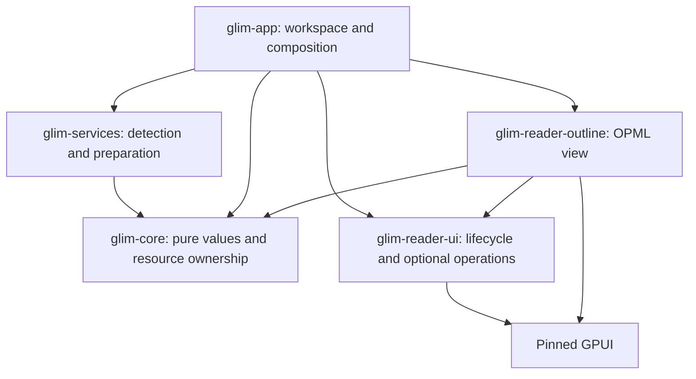

# Reader module contracts

**English** · [简体中文](reader-modules.zh-CN.md) · [Architecture](architecture.md)

The extension unit is an internal, statically linked reader package. New formats can reuse existing presentations. Scenario pages compose document, data, media and editing capabilities without introducing a second dispatcher. External plugin installation/loading is deferred.

## Dependency and ownership boundaries

Core has no runtime I/O or UI dependencies. Services own source access, parsing, preparation and persistence, never views. Reader-ui depends only on GPUI and exports `ReaderView`, `ReaderHost` and optional operation traits. Outline is a real independently compiled presentation, not a placeholder: its only workspace dependencies are core and reader-ui. These are workspace packages, not published artifacts or a stable external SDK.

`ReaderView` requires kind and rendering, and offers activation/window hooks. `ReaderOperations` borrows only supported image-copy, extraction, playback-state and persistence traits. App-local `ReaderSurface` adds refresh policy; native/SQLite implementations can retain in-place state. `SurfaceEntity` adapts app-owned GPUI entities without violating Rust's orphan rules. The shared source/markup/paged path remains explicit because it owns editing transitions.

`ReaderHost` injects translation and static module/action telemetry callbacks. Independent presentation code does not reach into app globals or service payloads. `glim-core::outline::Document` is the prepared OPML value; services reexport it, and the app factory constructs `OutlineSurface`. The source fixture and expected payload in `assets/reader-contracts/outline.*` cover hierarchy/order, Unicode, entity decoding and URL filtering. Producer and presentation regression cases consume the same expected payload, including collapse/expand behavior. Changes to the payload require updating both consumers and fixtures together; no binary compatibility is promised between internal revisions.

## Adding or extracting a reader

1. Declare suffix sets, provider claims and relevant association/icon expectations in `assets/format-catalog.json`. Run `python3 scripts/generate-format-catalog.py --write`. Filename-specific language rules and content probes remain code. Catalog claims are not edit permissions.
2. Implement detection/preparation in services. Keep dedicated containers before generic archive routing, preserve ambiguous-format probes, cancellation and complete-source fallbacks. Reuse existing `documents::Content`/`TextPresentation` values when appropriate.
3. Assemble retained entities in `reader/construction`. A package owns its presentation state and implements the narrow UI contract; the app adapter owns refresh/session integration. Keep filesystem work and blocking commands out of render/layout.
4. Expose actions through `workspace/reader_actions` or native `ReaderActions`; content menus use the same live actions. Unsupported optional traits remain absent. Retain tasks and resource leases until their real owners finish.
5. Add representative producer/consumer contract fixtures when crossing a package boundary. For native requests, update both sides of the versioned Rust/Swift protocol and `native/tests/fixtures`.
6. Update the architecture dependency guard and current behavior documentation. Run catalog/architecture checks and native Cargo compilation. Runtime tests and UI verification are separate from all-targets compilation.

Do not split every suffix into a crate. Extract when a coherent payload/view can compile without app globals and the maintenance benefit exceeds the additional interface. OPML demonstrates this boundary; source editing, native document adapters and other readers still live in their existing packages.

## State, work and publication

`DocumentSession` owns identity, path, saved-content snapshot, revision and optional `EditSession`. The edit session retains the editor, saved baseline, dirty/locked state and subscriptions. Source and preview share it; first save or window transfer preserves undo/history identity. Saving records the snapshot actually written, so typing during a save remains dirty. Read-only surfaces do not acquire an edit session.

Refresh publication checks document identity, generation and relevant edit/page revisions. Dirty content is protected; failed refresh retains the readable old view. SQLite supplies in-place refresh through the adapter. Use `app/reader_jobs` for preparation with retained cancellation; viewport/interactive/background admission, resource leases and cache reconstruction follow [resources and rendering](reader-resources.md).

`scripts/check-architecture.py` checks workspace dependency direction, known UI dependencies in non-UI crates, provider ordering/identity, generated catalog consistency and common workspace-dispatch regressions. It is a source guard, not a proof that arbitrary Rust performs no I/O or is cancellable. Remaining work is incremental extraction of coherent readers and broader resource coverage. External plugins additionally need version negotiation, permissions and failure isolation before any loading mechanism is added.
