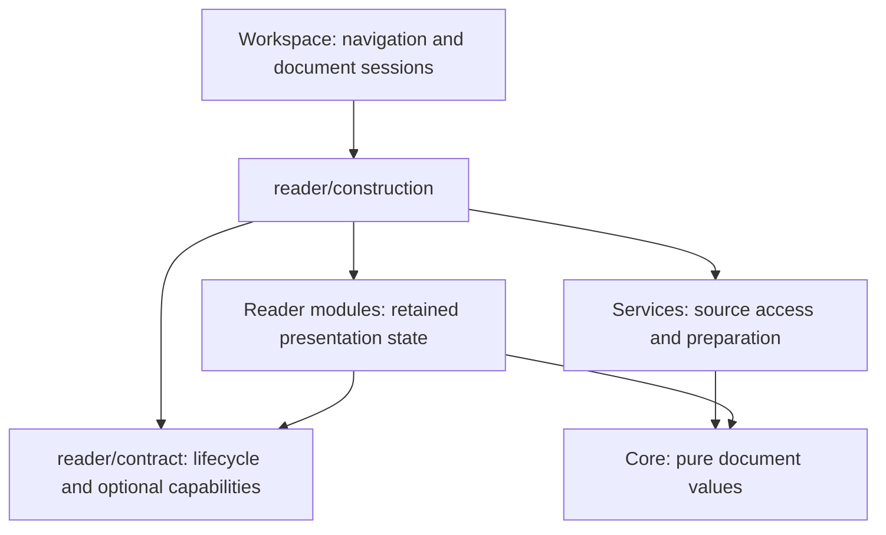

# Reader module contracts

**English** · [简体中文](reader-modules.zh-CN.md) · [Architecture](architecture.md)

Glim keeps three crates: app, services and core. Reader modularity is enforced through ownership and dependency boundaries inside them. A new format can reuse an existing view; scenarios compose document, data, media and editing capabilities without another dispatcher. External plugin installation/loading is deferred.

## Interfaces and ownership

`ReaderView` requires kind and rendering, with activation/window hooks. Workspace visibility is authoritative for activation, including keyboard tab switches and returning from settings/loading. `Reader` delivers only state transitions; a newly constructed hidden reader still receives its first deactivation. `ReaderOperations` borrows only implemented image-copy, extraction, playback-state and persistence traits. `ReaderSurface` adds app-owned refresh policy; native/SQLite implementations can retain in-place state. `SurfaceEntity` adapts existing GPUI entities. Source/markup/paged composition stays explicit because it owns shared editing transitions.

`ReaderHost` supplies translation, typed numeric action metadata and the shared resource pool. OPML and graph presentations use this host and pure `glim-core::outline`/`graph` payloads, without importing service implementations or application globals. The graph presentation serves XMind and structured-data visualization. Both have source/payload fixtures in `assets/reader-contracts`, shared by producer and presentation regression cases. Fixtures cover hierarchy/order, Unicode, URLs and fold behavior. They are internal contracts, not a serialized external plugin protocol.

`glim-core::table::TablePage` carries CSV/geographic page rows, column count and continuation state. `reader/csv/view` consumes this payload and injected translation, action metrics, detail callback and display policy; it emits semantic page requests. `reader/csv` owns file access, navigation history, background work and cancellation. Shared producer/consumer fixtures cover Unicode, quoted multiline cells, empty cells and ragged records.

Prepared table results cross the service/view boundary as immutable `glim-core::resources::TextRows`, retaining their working admission with the cells. CSV/TSV, geographic and SQLite views do not reconstruct a second resource charge after publication. Text/hex pages similarly retain text, row ranges, widest-row metadata and their reservation in the prepared page.

`glim-core::table::SqlitePage` preserves a fixed SQLite row page and its independent column-window offset. `reader/sqlite/view` retains table/input/scroll state and receives translation, display policy, status and an opaque detail entity; semantic requests carry user intent to `reader/sqlite`. That adapter owns snapshots, query coordination, cancellation, clipboard publication and the read-only detail editor. Contract regressions cover admitted cell handoff, repeated suspension/scroll restoration, control events, query replacement, pending filters at hiding, retained details, failed refresh and retry. The adapter fixtures use macOS's `/usr/bin/sqlite3` only to create the test database from `assets/reader-contracts/sqlite.sql`; production browsing stays in services. These tests do not establish physical input, Intel or complete window-transfer acceptance.

`glim-core::books` owns book format/catalog entry and reading-state values; services re-export them without changing storage encoding. `books/view` receives a borrowed `Catalog`, policy and host callbacks, prepared chapter text/anchors, image resolution and opaque source-page views. It owns selection, scroll, navigation and the latest pending reading state. The adapter owns cancellable preparation, concrete images/pages, preference I/O and window-bound requests. Contract tests cover shared catalog/resource ownership, selection pinning, navigation requests, interrupted preference restoration, hidden queued navigation, pending-write drain before event delivery, writes after reader disposal, chapter replacement, failed restoration and window rebinding after the source window closes. The EPUB fixture in `assets/reader-contracts/book.epub.json` is assembled with macOS `/usr/bin/zip` only during test setup; FB2 uses `book.fb2`. Tests inject independent schedulers and in-memory preference storage, leaving personal reading history untouched. Physical input, Intel and full workspace transfer remain outside those tests.

Raster results cross that boundary through `glim-services::media::RasterFrame`, which owns an `image::Frame` and its working reservation without GPUI types. PNG preparation and GIF playback acquire admission before allocating pixels; the app converts channels in place and transfers both pixels and reservation into its display owner. GIF playback also accepts an explicit resource pool for independent preparation and measurement. This isolates buffer ownership; media views still use application scheduling and service entry points.

Workspace owns navigation and session coordination. `DocumentSession` owns identity, path, saved snapshot, revision and optional `EditSession`; source and preview share the editor, baseline, dirty/locked state and subscriptions. First save/window transfer preserves undo and recovery identity. Save completion confirms the snapshot actually written; newer typing remains dirty. Refresh publication checks identity/generation and relevant edit/page revisions, protecting dirty content and preserving readable views on failure.

Structured-tree payloads live in `glim-core::structured`. `TreeBuilder` admits node strings, node slots, child indexes and vector reallocation overlap before allocation; immutable `Tree` keeps that reservation through handoff. JSON/JSONC/JSON5/JSONL and the structured graph's intermediate nodes share this representation. `reader/json/view` consumes the payload, host hooks, a detail-dialog callback and injected expansion policy; `reader/json` owns preparation, cancellation, source reconstruction and retry. The presentation module does not import services or application globals. Derived graph output uses `glim-core::graph::PreparedGraph` to keep its working reservation through worker/view handoff; the XMind file payload retains its existing state accounting.

## Adding a format

Document search is an optional `ReaderView::can_find`/`find` capability. Route its trigger through the shared reader actions; keep the search UI, cancellation and match state with the retained reader. Source and Markdown compose `reader/find`; native HTML, PDF and Word reading surfaces use `ReaderFind.swift`. A reader must not advertise search for a mode its backend cannot search.

1. Update suffix sets, provider claims and relevant association/icon expectations in `assets/format-catalog.json`, then run `python3 scripts/generate-format-catalog.py --write`. Filename language rules and content probes remain code. Catalog declarations do not grant editability.
2. Implement detection/preparation in services, preserving ordered container routing, cancellation and complete-source fallbacks. Reuse `documents::Content`/`TextPresentation` where suitable.
3. Compose retained entities in `reader/construction`. Views consume prepared values; render/layout do not read files or run blocking commands. Add a capability only when there is a concrete caller and implementation.
4. Route actions through `workspace/reader_actions` or native `ReaderActions`, reusing live actions for content menus. Keep task/resource ownership explicit; follow [resource lifecycle](reader-resources.md).
5. When crossing a module boundary, add representative producer/consumer fixtures. Native requests retain their versioned Rust/Swift protocol and `native/tests/fixtures`. Update architecture checks and current behavior documentation.

## When to split a crate

A separate crate requires an actual independent-version, dependency-isolation or reuse requirement. Interface size, number of supported extensions and a desire for a tidier directory do not establish that requirement. Before extracting, show that the module can operate through prepared values and host operations, identify who will maintain/version it, and justify the added build and adapter overhead. Current reader modules stay in the app crate.

`scripts/check-architecture.py` checks the three-crate direction, known UI dependencies in core/services, provider/catalog consistency and workspace dispatch regressions. It also rejects direct service/app-global/filesystem imports in the contract, controls, OPML, graph, table, book and structured-tree presentation modules. These source guards supplement native Cargo compilation; they do not prove arbitrary Rust is I/O-free or cancellable. All-targets compilation checks test code without executing it. Runtime and macOS interaction verification remain separate.
