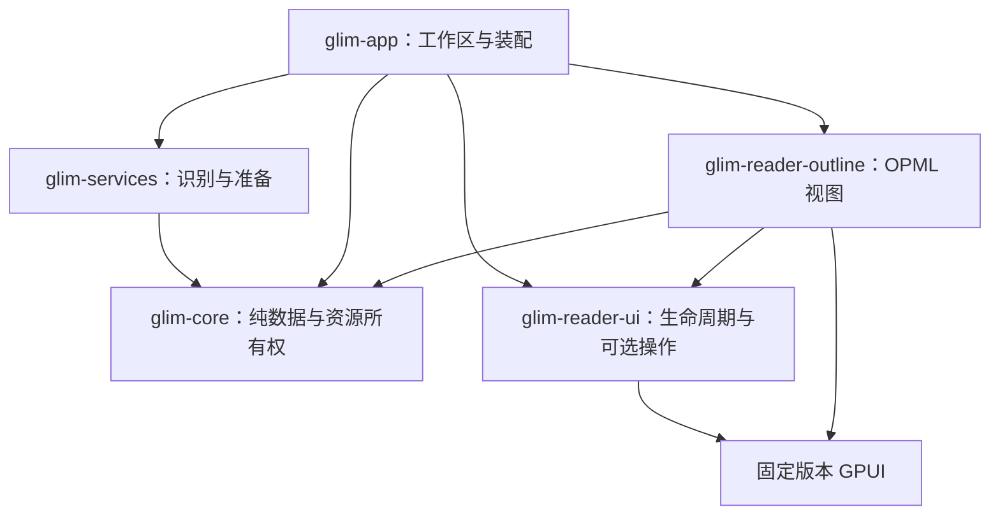

# 阅读器模块契约

[English](reader-modules.md) · **简体中文** · [架构](architecture.zh-CN.md)

扩展单元是内部静态链接的阅读器包。新格式可以复用已有视图；场景专题组合文档、数据、媒体和编辑能力，不新增另一套分发。外部插件安装和动态加载留待后续。

## 依赖与所有权

Core 不执行运行时 I/O，也不依赖 UI。服务层负责源访问、解析、准备和持久化，不持有视图。Reader-ui 仅依赖 GPUI，导出 `ReaderView`、`ReaderHost` 和可选操作接口。Outline 是已经独立编译的完整视图，工作区依赖只有 core 和 reader-ui。这些是工作区内的包，尚未发布，也不承诺稳定外部 SDK。

`ReaderView` 要求类型标识和渲染，提供激活／窗口钩子。`ReaderOperations` 仅借用实际支持的图片复制、解压、播放状态和持久化接口。应用内部 `ReaderSurface` 补充刷新策略，原生／SQLite 可保留原位状态。`SurfaceEntity` 适配应用自有 GPUI 实体，满足 Rust 孤儿规则。源码／排版／分页继续显式组合，便于维护共享编辑状态转换。

`ReaderHost` 注入翻译和静态模块／动作记录回调，独立视图不访问应用全局或服务载荷。`glim-core::outline::Document` 是 OPML 准备数据，服务层重导出，应用工厂构造 `OutlineSurface`。`assets/reader-contracts/outline.*` 的源文件和期望载荷覆盖层级顺序、Unicode、实体解码及 URL 过滤；生产者和视图回归共用期望数据，并检查折叠／展开行为。修改载荷时同步更新消费者和样例，内部版本之间不承诺二进制兼容。

## 新增或拆出阅读器

1. 在 `assets/format-catalog.json` 声明后缀集合、提供者及相关系统关联／图标预期，运行 `python3 scripts/generate-format-catalog.py --write`。特殊文件名语言规则和内容探测保留代码实现，目录声明不授予编辑权限。
2. 在服务层实现识别和准备。专用容器先于通用压缩包，保留歧义探测、取消及完整源后备；优先复用 `documents::Content`／`TextPresentation`。
3. 在 `reader/construction` 装配持久实体。独立包拥有视图状态并实现窄 UI 契约，应用适配器负责刷新／会话整合。render／layout 不执行文件读取或阻塞命令。
4. 操作经 `workspace/reader_actions` 或原生 `ReaderActions` 暴露，内容菜单复用同一组实际动作。不支持的可选接口保持缺省，任务和资源租约跟随真实所有者直到结束。
5. 跨包时增加有代表性的生产者／消费者契约样例。原生请求同时更新带版本的 Rust／Swift 协议与 `native/tests/fixtures`。
6. 更新架构依赖检查和当前行为文档，执行目录／架构检查及原生 Cargo 编译。运行测试、UI 验证与全目标编译分开处理。

不按每个扩展名单独拆 crate。能够脱离应用全局独立编译、载荷与视图职责完整且维护收益足够时再拆包。OPML 已证明这个边界；源码编辑、原生适配器及其他阅读器仍在现有包内。

## 状态、任务与发布结果

`DocumentSession` 拥有身份、路径、保存快照、修订及可选 `EditSession`。编辑会话持有编辑器、保存基线、脏／锁定状态和订阅，源码／预览共用；首次保存和跨窗口移动保留撤销及恢复身份。保存只确认实际写入的快照，因此保存期间继续输入仍保持脏状态。只读视图不获取编辑会话。

刷新发布核对文档身份、代次及相关编辑／页面版本。脏内容受保护，刷新失败保留原可读视图；SQLite 经适配器原位更新。准备任务使用 `app/reader_jobs` 并持有取消句柄；视口／交互／后台准入、资源租约和缓存重建见[资源与渲染](reader-resources.zh-CN.md)。

`scripts/check-architecture.py` 检查工作区依赖方向、非 UI 包的已知 UI 依赖、提供者顺序／身份、目录生成一致性及工作区常见分发回流。它是源码守卫，无法证明任意 Rust 不执行 I/O 或始终可取消。后续按完整职责逐个拆分阅读器、扩大资源覆盖；外部插件在引入加载机制前还需版本协商、权限和故障隔离。
