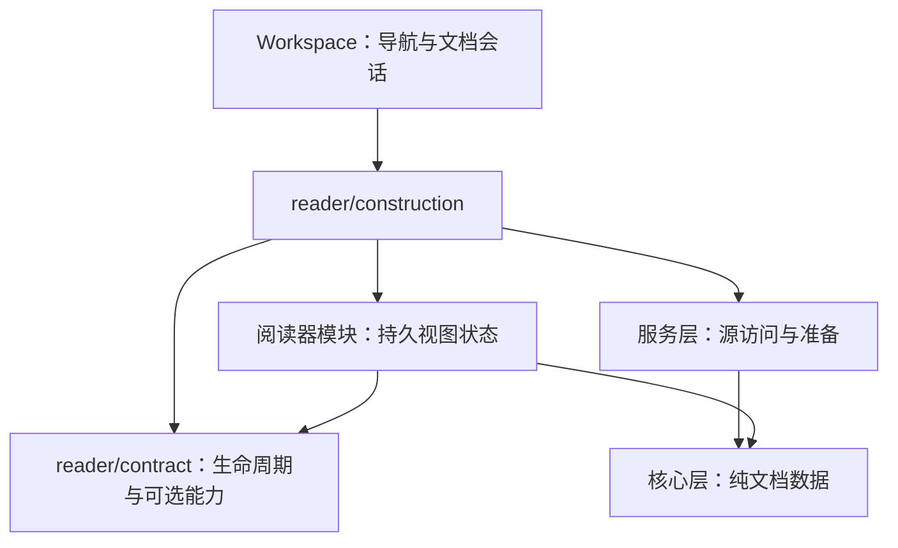

# 阅读器模块契约

[English](reader-modules.md) · **简体中文** · [架构](architecture.zh-CN.md)

Glim 保持 app、services、core 三个 crate，阅读器通过内部模块的所有权与依赖边界隔离。新格式可以复用已有视图；场景组合文档、数据、媒体和编辑能力，不新增另一套分发。外部插件安装和动态加载留待后续。

## 接口与所有权

`ReaderView` 要求类型标识和渲染，提供激活／窗口钩子。工作区按实际可见性同步激活状态，覆盖键盘切换标签、返回设置页和加载占位结束等路径。`Reader` 只传递状态变化；新建但不可见的阅读器仍会收到首次停用通知。`ReaderOperations` 只借用实际实现的图片复制、解压、播放状态和持久化接口。`ReaderSurface` 补充应用侧刷新策略，原生／SQLite 可保留原位状态；`SurfaceEntity` 适配现有 GPUI 实体。源码／排版／分页保留显式组合，方便维护共享编辑状态转换。

`ReaderHost` 提供翻译、类型化数值动作记录和共享资源池。OPML 与图结构视图通过宿主和 `glim-core::outline`／`graph` 纯数据工作，不直接引用服务实现或应用全局。图结构视图同时用于 XMind 与结构化数据可视化。`assets/reader-contracts` 中的源文件／期望载荷由生产者与视图回归共用，覆盖层级顺序、Unicode、URL 和折叠行为；这些是内部契约，不是序列化的外部插件协议。

工作区负责导航与会话协调。`DocumentSession` 拥有身份、路径、保存快照、修订和可选 `EditSession`；源码／预览共享编辑器、基线、脏／锁定状态和订阅。首次保存和跨窗口移动保留撤销及恢复身份。保存只确认实际写入的快照，新输入继续保持脏状态。刷新发布检查身份、代次和相关编辑／页面版本，保护脏内容，失败时保留原可读视图。

`glim-core::table::TablePage` 携带 CSV／地理表格的行、列数与后续页状态。`reader/csv/view` 消费载荷及注入的翻译、动作记录、详情回调和展示策略，只发出语义翻页请求；`reader/csv` 负责文件访问、导航历史、后台任务和取消。生产者／消费者共用夹具，覆盖 Unicode、带引号的多行单元格、空值与不齐整记录。

表格结果以不可变的 `glim-core::resources::TextRows` 跨越服务／视图边界，单元格与工作预留一起传递；CSV／TSV、地理坐标和 SQLite 视图无需收到结果后重新记账。文本／十六进制准备页同样持有文本、行范围、最宽行元数据及预留。

`glim-core::table::SqlitePage` 保留 SQLite 固定行页及独立的列窗口偏移。`reader/sqlite/view` 拥有表格、输入和滚动状态，只接收翻译、展示策略、状态及不透明详情实体，通过语义请求把用户意图交给 `reader/sqlite`；适配器负责快照、查询协调、取消、剪贴板发布和只读详情编辑器。契约回归覆盖已准入单元格交接、重复隐藏／滚动恢复、控件事件、查询替换、隐藏时待应用筛选、详情保留、刷新失败与重试。适配器夹具仅在测试准备阶段用 macOS 的 `/usr/bin/sqlite3` 执行 `assets/reader-contracts/sqlite.sql` 建库，生产查询仍由 services 执行；这些测试不代表物理输入、Intel 或完整跨窗口移动验收。

`glim-core::books` 拥有书籍格式／目录条目及阅读状态值，services 保留重导出，存储编码不变。`books/view` 接收借用的 `Catalog`、策略、宿主回调、准备好的章节文字／锚点、图片解析器和不透明源码页；负责选区、滚动、导航及最新待写阅读状态。适配器负责可取消准备、具体图片／分页实体、偏好 I/O 和窗口请求绑定。契约测试覆盖共享目录／资源所有权、选区固定、导航请求、偏好恢复中断、隐藏时排队导航、事件送达前的待写排空、阅读器关闭后写完、章节替换、恢复失败，以及源窗口关闭后的重绑。EPUB 夹具 `assets/reader-contracts/book.epub.json` 仅在测试准备时用 macOS `/usr/bin/zip` 组装；FB2 使用 `book.fb2`。测试注入独立调度器和内存偏好存储，不写个人阅读历史；物理输入、Intel 和完整工作空间迁移仍待验收。

像素结果通过 `glim-services::media::RasterFrame` 跨越边界，同时持有 `image::Frame` 和工作预留，不含 GPUI 类型。PNG 准备和 GIF 播放在分配像素前取得额度；应用原地交换颜色通道，再将像素与预留共同交给显示所有者。GIF 播放也接受显式资源池，支持独立准备与测量。这落实了缓冲所有权隔离；媒体视图仍使用应用调度器和服务入口。

结构树载荷位于 `glim-core::structured`。`TreeBuilder` 在分配前为节点字符串、节点槽位、子节点索引和向量扩容重叠申请预算；不可变 `Tree` 在交付后继续持有预留。JSON／JSONC／JSON5／JSONL 与结构化交互图的中间节点共用该表示。`reader/json/view` 只消费载荷、宿主操作、详情对话回调和注入的展开策略；`reader/json` 负责准备、取消、输入重建与重试。展示模块不引用服务或应用全局。交互图最终输出由 `glim-core::graph::PreparedGraph` 在工作线程到视图的交接中持续持有预留；XMind 文件载荷保留原有状态记账。

## 新增格式

1. 在 `assets/format-catalog.json` 更新后缀集合、提供者及相关关联／图标预期，运行 `python3 scripts/generate-format-catalog.py --write`。文件名语言规则和内容探测保留代码实现，目录声明不授予编辑权限。
2. 在服务层实现识别与准备，保留容器路由顺序、取消及完整源后备；适合时复用 `documents::Content`／`TextPresentation`。
3. 在 `reader/construction` 装配持久实体。视图消费准备数据，render／layout 不读文件或执行阻塞命令。只有同时存在实际调用方和实现时才增加能力接口。
4. 操作经 `workspace/reader_actions` 或原生 `ReaderActions` 暴露，内容菜单复用同一组实际动作；任务与资源所有权遵循[资源生命周期](reader-resources.zh-CN.md)。
5. 跨模块边界增加有代表性的生产者／消费者样例。原生请求保留带版本的 Rust／Swift 协议与 `native/tests/fixtures`。同步更新架构检查和当前行为文档。

## 何时拆 crate

单独 crate 需要真实的独立版本、依赖隔离或复用需求。接口数量、支持扩展名数量、目录看起来整齐，都不足以证明需要拆包。拆分前需证明模块可通过准备数据和宿主操作运行，明确独立维护／版本责任，并说明新增构建与适配成本的收益。当前阅读器保留在 app crate 内。

`scripts/check-architecture.py` 检查三层依赖、core／services 中的已知 UI 依赖、提供者／目录一致性及工作区分发回流；同时检查契约、共享控件、OPML、图结构、表格、书籍及结构树展示模块不直接引用服务、应用全局或文件系统。源码守卫补充原生 Cargo 编译，不能证明任意 Rust 不执行 I/O 或始终可取消。全目标编译只检查测试代码，不执行测试；运行回归及 macOS 交互需单独验证。
