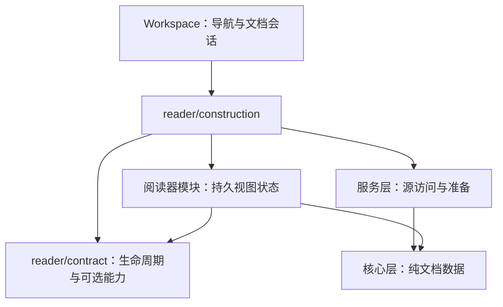

# 阅读器模块契约

[English](reader-modules.md) · **简体中文** · [架构](architecture.zh-CN.md)

Glim 保持 app、services、core 三个 crate，阅读器通过内部模块的所有权与依赖边界隔离。新格式可以复用已有视图；场景组合文档、数据、媒体和编辑能力，不新增另一套分发。外部插件安装和动态加载留待后续。

## 接口与所有权

`ReaderView` 要求类型标识和渲染，提供激活／窗口钩子。工作区按实际可见性同步激活状态，覆盖键盘切换标签、返回设置页和加载占位结束等路径。`Reader` 只传递状态变化；新建但不可见的阅读器仍会收到首次停用通知。`ReaderOperations` 只借用实际实现的图片复制、解压、播放状态和持久化接口。`ReaderSurface` 补充应用侧刷新策略，原生／SQLite 可保留原位状态；`SurfaceEntity` 适配现有 GPUI 实体。源码／排版／分页保留显式组合，方便维护共享编辑状态转换。

`ReaderHost` 提供翻译、类型化数值动作记录和共享资源池。OPML 与图结构视图通过宿主和 `glim-core::outline`／`graph` 纯数据工作，不直接引用服务实现或应用全局。图结构视图同时用于 XMind 与结构化数据可视化。`assets/reader-contracts` 中的源文件／期望载荷由生产者与视图回归共用，覆盖层级顺序、Unicode、URL 和折叠行为；这些是内部契约，不是序列化的外部插件协议。

工作区负责导航与会话协调。`DocumentSession` 拥有身份、路径、保存快照、修订和可选 `EditSession`；源码／预览共享编辑器、基线、脏／锁定状态和订阅。首次保存和跨窗口移动保留撤销及恢复身份。保存只确认实际写入的快照，新输入继续保持脏状态。刷新发布检查身份、代次和相关编辑／页面版本，保护脏内容，失败时保留原可读视图。

表格结果以不可变的 `glim-core::resources::TextRows` 跨越服务／视图边界，单元格与工作预留一起传递；CSV／TSV、地理坐标和 SQLite 视图无需收到结果后重新记账。文本／十六进制准备页同样持有文本、行范围、最宽行元数据及预留。

像素结果通过 `glim-services::media::RasterFrame` 跨越边界，同时持有 `image::Frame` 和工作预留，不含 GPUI 类型。PNG 准备和 GIF 播放在分配像素前取得额度；应用原地交换颜色通道，再将像素与预留共同交给显示所有者。GIF 播放也接受显式资源池，支持独立准备与测量。这落实了缓冲所有权隔离；媒体视图仍使用应用调度器和服务入口。

## 新增格式

1. 在 `assets/format-catalog.json` 更新后缀集合、提供者及相关关联／图标预期，运行 `python3 scripts/generate-format-catalog.py --write`。文件名语言规则和内容探测保留代码实现，目录声明不授予编辑权限。
2. 在服务层实现识别与准备，保留容器路由顺序、取消及完整源后备；适合时复用 `documents::Content`／`TextPresentation`。
3. 在 `reader/construction` 装配持久实体。视图消费准备数据，render／layout 不读文件或执行阻塞命令。只有同时存在实际调用方和实现时才增加能力接口。
4. 操作经 `workspace/reader_actions` 或原生 `ReaderActions` 暴露，内容菜单复用同一组实际动作；任务与资源所有权遵循[资源生命周期](reader-resources.zh-CN.md)。
5. 跨模块边界增加有代表性的生产者／消费者样例。原生请求保留带版本的 Rust／Swift 协议与 `native/tests/fixtures`。同步更新架构检查和当前行为文档。

## 何时拆 crate

单独 crate 需要真实的独立版本、依赖隔离或复用需求。接口数量、支持扩展名数量、目录看起来整齐，都不足以证明需要拆包。拆分前需证明模块可通过准备数据和宿主操作运行，明确独立维护／版本责任，并说明新增构建与适配成本的收益。当前阅读器保留在 app crate 内。

`scripts/check-architecture.py` 检查三层依赖、core／services 中的已知 UI 依赖、提供者／目录一致性及工作区分发回流；同时检查契约、共享控件、OPML 和图结构模块不直接引用服务、应用全局或文件系统。源码守卫补充原生 Cargo 编译，不能证明任意 Rust 不执行 I/O 或始终可取消。全目标编译只检查测试代码，不执行测试；运行回归及 macOS 交互需单独验证。
