# 北岸观测站交接记录

这份记录使用虚构的观测数据。同一份源文件用于比对 Glim 预览、浏览器 HTML 和 PDF。先找页首的站标，再看图集，最后核对文末的交接编号，即可确认长文首尾都已呈现。

导航：[排版](#typography) · [图像与折叠](#media) · [图集](#atlas) · [交接清单](#handoff)

<p align="center">
  <a href="../README.zh-CN.md"></a>
  <br><strong>北岸 · 四月夜班</strong>
</p>

站标应居中，下一行是粗体站名。这里的 `<p>` 则应保留尖括号。

<a id="typography"></a>

排版与读数
----------

### 采样手记

凌晨的第一组读数是 **12.8 °C**，*微风*，***能见度良好***。旧值 ~~21.8 °C~~ 已划去。另一位记录员用 __粗体__ 和 _斜体_ 签出了站号 `north_bank_01`。
这一行在源码中另起一行，仍属于同一段。

第一行末尾使用反斜杠硬换行。\
这句应从第二行开始。

#### 字符与字面量

转义样本：\*星号\*、\[方括号\]、\#井号、1\. 句点。实体样本：A &amp; B、&lt;sensor&gt;、&#176;C。行内代码可以包含反引号：`` a ` b ``。组合字符 café / café 与中日韩文字「北岸・測定・관측」应可辨认。

##### 单位

水样含 H<sub>2</sub>O；面积为 9 m<sup>2</sup>。按 <kbd>⌘</kbd> + <kbd>S</kbd> 保存。

###### 记录尾注

潮位采用本地零点[^datum]。下一班仍使用同一零点[^datum]；校时方法另有说明[^clock]。

***

班次安排
========

3. 取样（编号从 3 开始）
   - 北岸桥下
     - 先采上游，后采下游。
   - 旧渡口
4. 复核

   两名记录员分别读数。这段仍属于第 4 项。

   > 差值超过半格时，保留两份原始记录。

5. 入册

- [x] 核对仪器序号
- [ ] 补录潮位
  - [x] 确认时间戳
  - [ ] 获取签名

> 早班留言：桥洞下回声较强。
>
> > 夜班回复：已改用岸边标尺。
>
> 末句应回到外层引用。

> [!NOTE]
> 原始表上的空格代表缺测。

> [!TIP]
> 可用交接编号查找末页。

> [!IMPORTANT]
> 归档时同时记录时区。

> [!WARNING]
> 两套标尺零点不同，不能直接拼接读数。

> [!CAUTION]
> 删除重复记录前先核对采样时间。

## 表格、链接与代码

| 站点（左） | 班次（中） | 潮位 cm（右） | 备注 |
| :--- | :---: | ---: | --- |
| 北岸 | 早 | 9 | 正常 |
| **旧渡口** | 夜 | 102 | 两个通道 A\|B |
| 桥下 | 夜 | −12 | `raw_02`，随后[复核][protocol] |
| 闸口 | 午 | | 缺测，数值格应为空 |

[站内说明](../README.zh-CN.md "中文说明")、[完整引用][protocol]、[简写引用][]、[观测规程]。网址自动链接 <https://example.org/>；邮件 <station@example.org>。

[protocol]: https://spec.commonmark.org/ "CommonMark 规范"
[简写引用]: ../README.md
[观测规程]: ../docs/file-format-support.zh-CN.md

```rust
fn corrected(raw: &[i16], offset: i16) -> Vec<i16> {
    raw.iter().map(|value| value - offset).collect()
}
```

~~~json
{"station":"北岸","samples":[9,102,-12,null],"verified":true}
~~~

    station    time     level
    NORTH      06:10        9

四反引号围栏内应完整显示下面三行 Markdown 源码：

````markdown
```html
<p>此处只显示代码。</p>
```
````

<a id="media"></a>

## 图像与折叠

[![仓库中的 Glim 矢量标识][logo]][简写引用]

[logo]: ../assets/branding/glim.svg "SVG 图像兼链接"

<details>
<summary>展开查看封存编号</summary>

封存编号 **NB-217**。浏览器初始折叠，点击摘要后可见；在 PDF 中直接搜索编号即可找到这一段。

</details>

<details open>
<summary>已公开的备注</summary>
<p>水面有薄雾，<strong>能见度记录有效</strong>。</p>
</details>

<!-- 这句内部批注应隐藏：NORTH-HIDDEN-091 -->

## 公式

行内校正值为 $h_c=h_r-\Delta h$，文字应与公式处于同一行。下式用三个读数求均值：

$$
\bar h = \frac{1}{n}\sum_{i=1}^{n}h_i = \frac{9+102-12}{3}=33
$$

```math
\begin{bmatrix}1&0\\0&1\end{bmatrix}
\begin{pmatrix}x\\y\end{pmatrix}
=\begin{pmatrix}x\\y\end{pmatrix}
```

<a id="atlas"></a>

## Mermaid 图集

每幅图有独立的对照点。缩窄窗口或导出后，检查中文标签、箭头方向、图例以及图形右边缘。

### 流程 · 漂移读数应返回复测

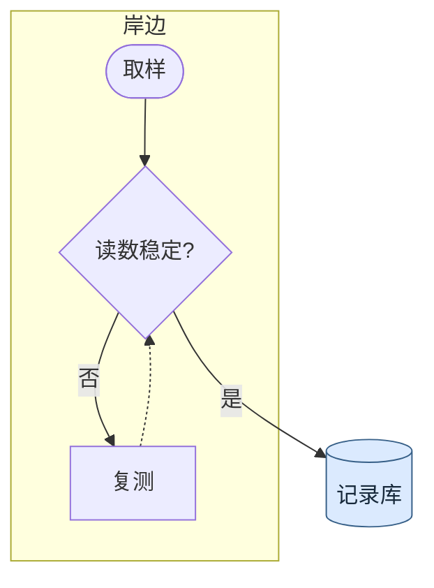

### 时序 · 两种结果共用一次请求

```mmd
sequenceDiagram
    autonumber
    actor O as 记录员
    participant R as 读数器
    O->>+R: 请求本轮读数
    alt 已稳定
        R-->>O: 返回潮位
    else 漂移中
        R-->>O: 请稍候
    end
    Note over O,R: 使用同一时区
    deactivate R
```

### 类图 · 一座站点对应多笔记录

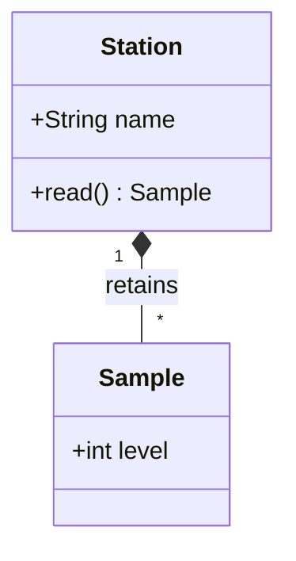

### 状态 · 草稿可以退回

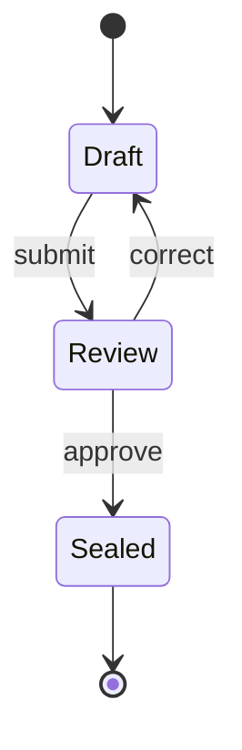

### 实体关系 · 外键连接站点

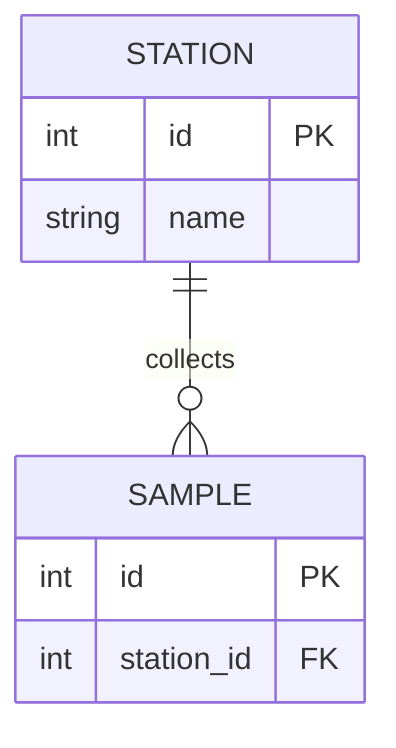

### 甘特 · 复核依赖采样完成

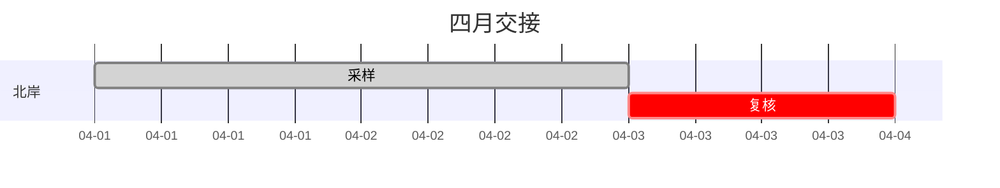

### 饼图 · 已复核占四分之三

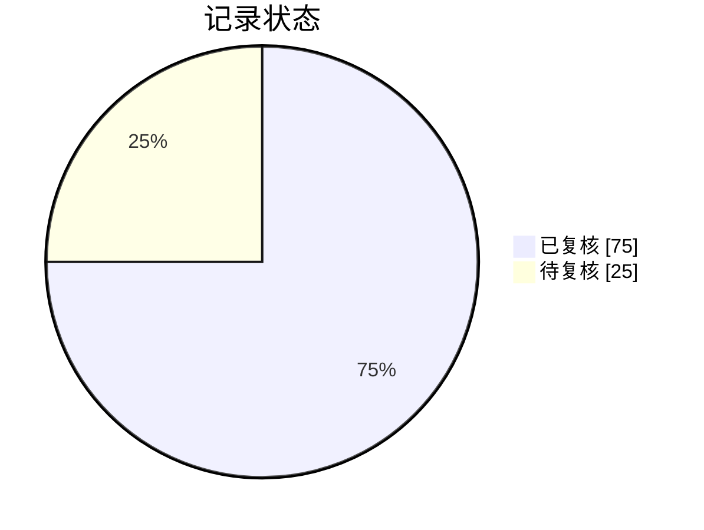

### 思维导图 · 两个分支各有一个叶节点

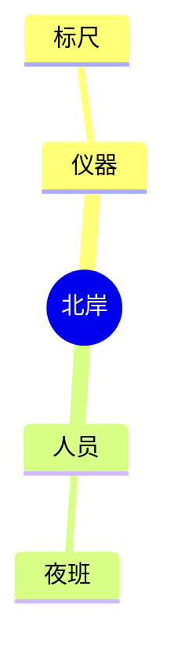

### 旅程 · 两人共同签收

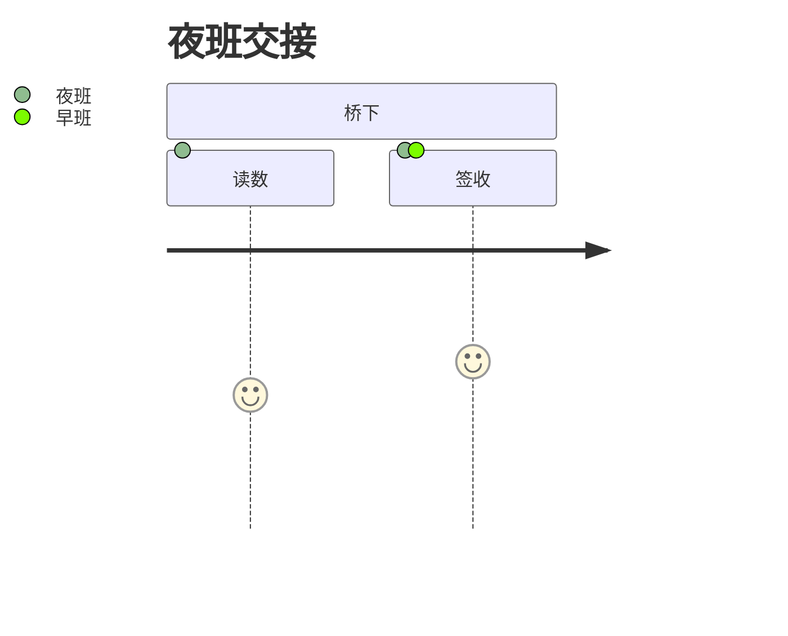

### 时间线 · 保留同一时刻的两项事件

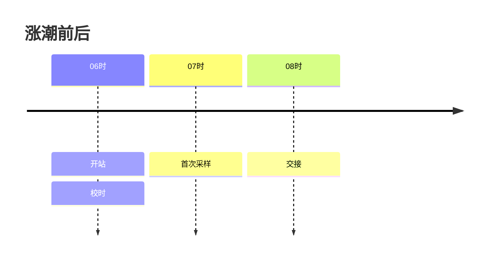

### Git 图 · 分支合入主线

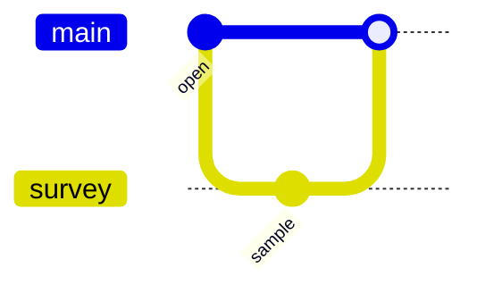

### 象限 · 两个点位于对角区域

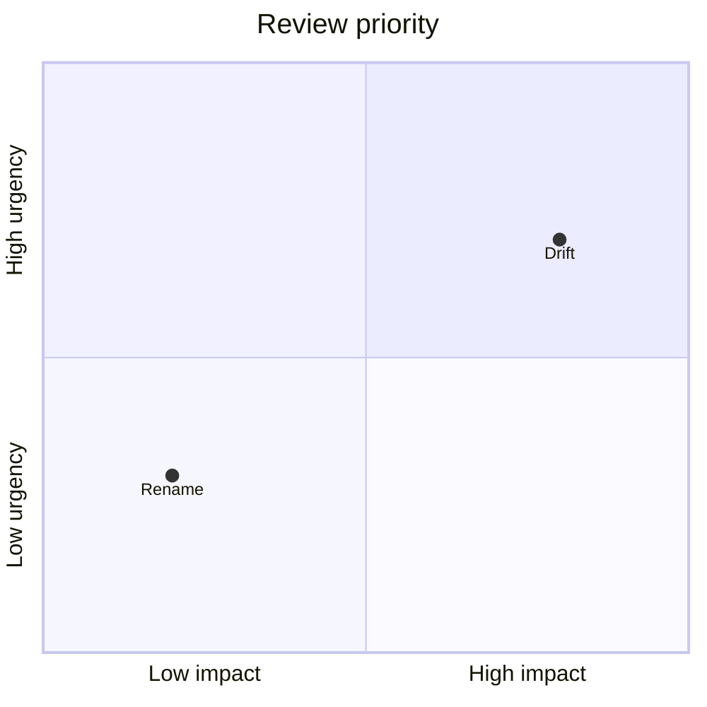

### 柱线组合 · 两条系列使用同一纵轴

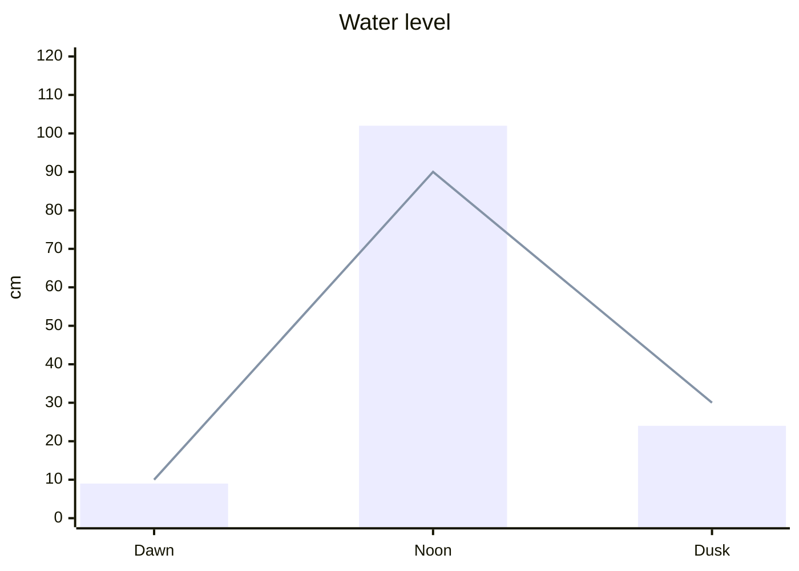

### 桑基 · 十二份样本分成九份和三份

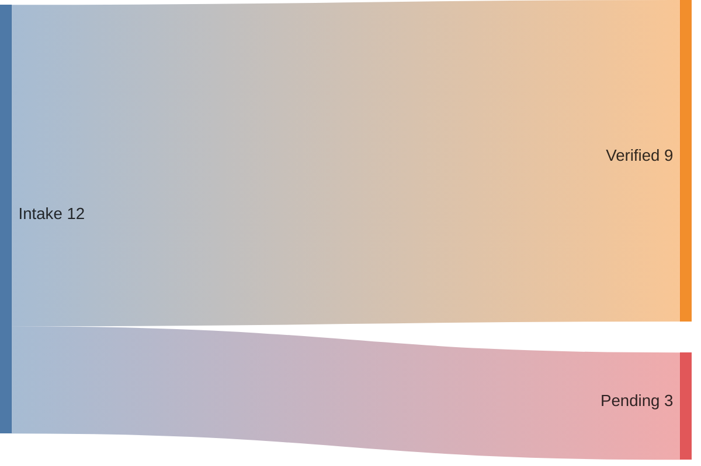

### 雷达 · 两个班次、三条指标轴

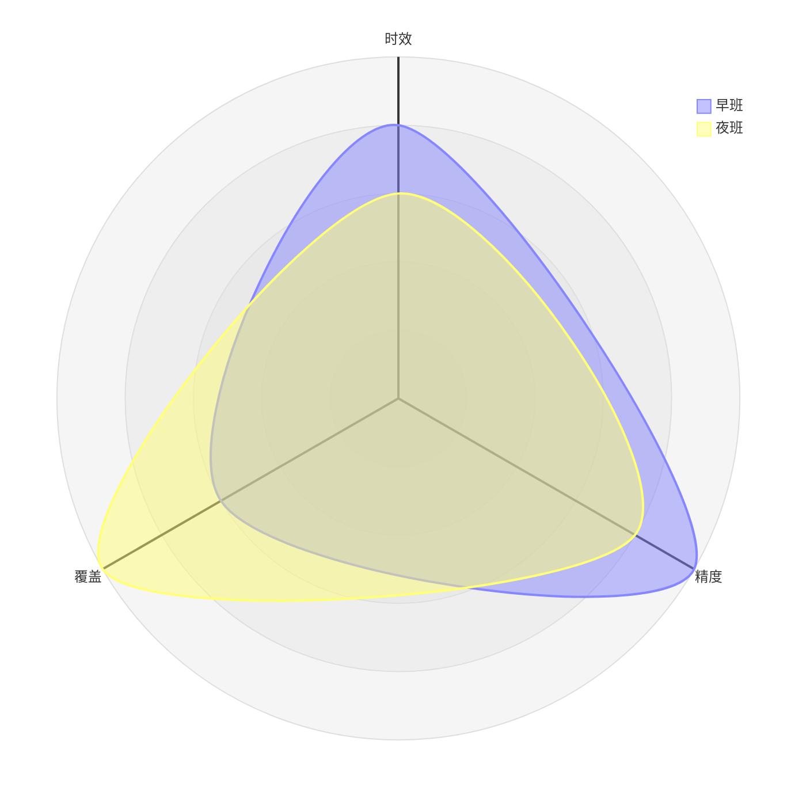

### 矩形树图 · 北岸的两块面积比为三比一

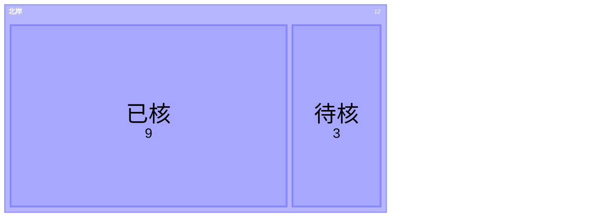

### 数据包 · 两个字段共占 32 位

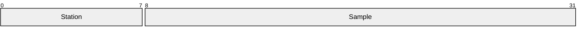

### 需求图 · 校准器满足精度要求

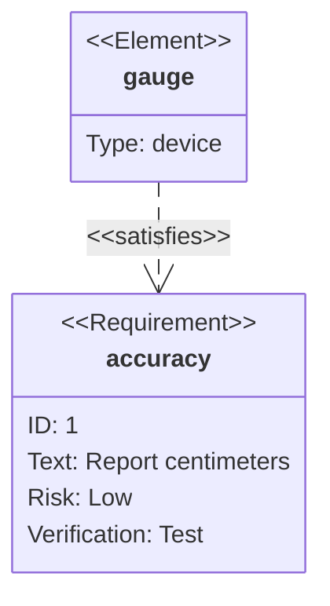

### 架构 · 采样服务写入同组数据库

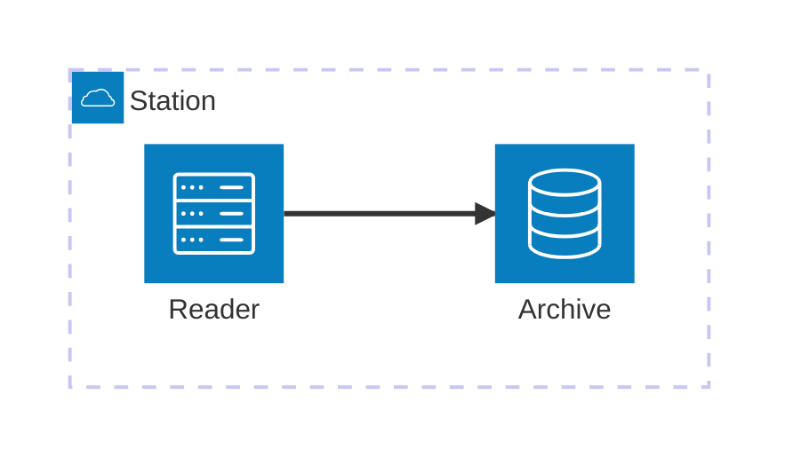

### 看板 · 两栏各有一项任务

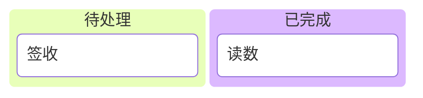

### 方块图 · 三列中的数据流

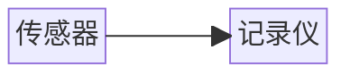

### C4 上下文 · 站员访问归档系统

```mermaid
C4Context
    Person(observer, "站员", "负责签收")
    System(archive, "档案库", "保存日报")
    Rel(observer, archive, "提交日报")
```

### ZenUML · 一次同步调用

```zenuml
Observer->Gauge.read()
```

## 其他图表围栏

以下四幅图分别核对有向边、应答虚线、判断分支、时钟与数据的对齐。

```dot
digraph Survey {
    rankdir=LR;
    raw [label="原始"];
    checked [label="复核", shape=box];
    raw -> checked [label="签收"];
}
```

```plantuml
@startuml
participant Observer
participant Gauge
Observer -> Gauge : read()
Gauge --> Observer : 33 cm
@enduml
```

```flow
st=>start: 取样
ok=>condition: 稳定?
fin=>end: 入册
st->ok
ok(yes)->fin
ok(no)->st
```

```wavedrom
{ "signal": [
  { "name": "clock", "wave": "p....." },
  { "name": "level", "wave": "x.3.4x", "data": ["09", "33"] }
] }
```

<a id="handoff"></a>

## 交接清单

| 操作 | 核对位置 | 预期结果 |
| --- | --- | --- |
| 切换源码与预览 | 站标、内部批注、四反引号围栏 | 站标变为图片，批注隐藏，围栏里的 HTML 保持字面形式 |
| 缩窄窗口并切换外观 | 表格、长公式、甘特图 | 数值与表头对应，标签和连线清晰可读 |
| 点击「在浏览器中打开」 | 操作栏、Dock、浏览器 | 准备期间原位显示进度；观察是否有额外 Dock 图标弹跳；默认浏览器打开新 HTML |
| 断网后重开导出的 HTML | PNG、SVG、图集、封存编号 | 本地图片和图表仍可见；折叠摘要可以展开 |
| 导出 PDF | 站标、跨页处、折叠段落、文末 | 无意外的 HTML 标签；页面边缘无裁切；可查到封存编号及交接编号 |
| 再次导出并取消 | 操作栏 | 进度提示结束，可重新发起导出 |

[^datum]: 四月一日校准，将桥柱底部刻线记为 0 cm。
[^clock]: 以 24 小时制记录本地时间，换班时写明 UTC+08:00。

**交接编号** `NORTH-042-END`
